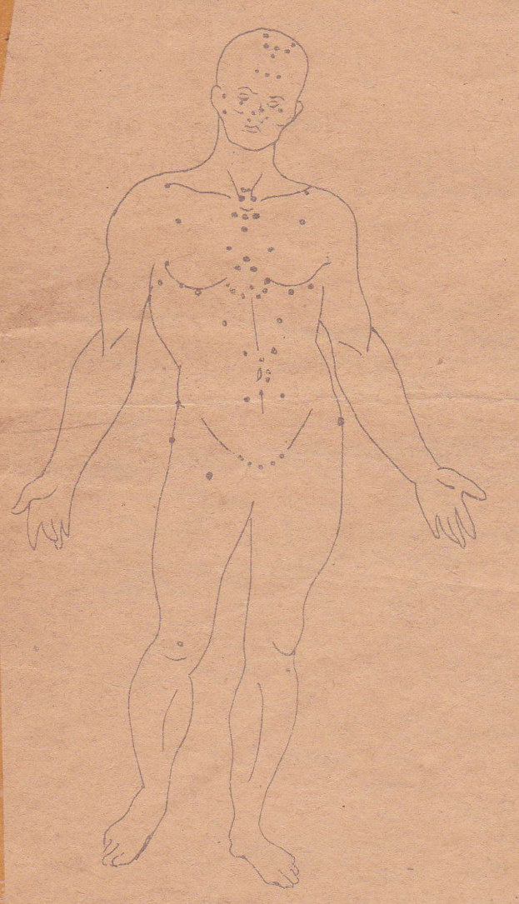
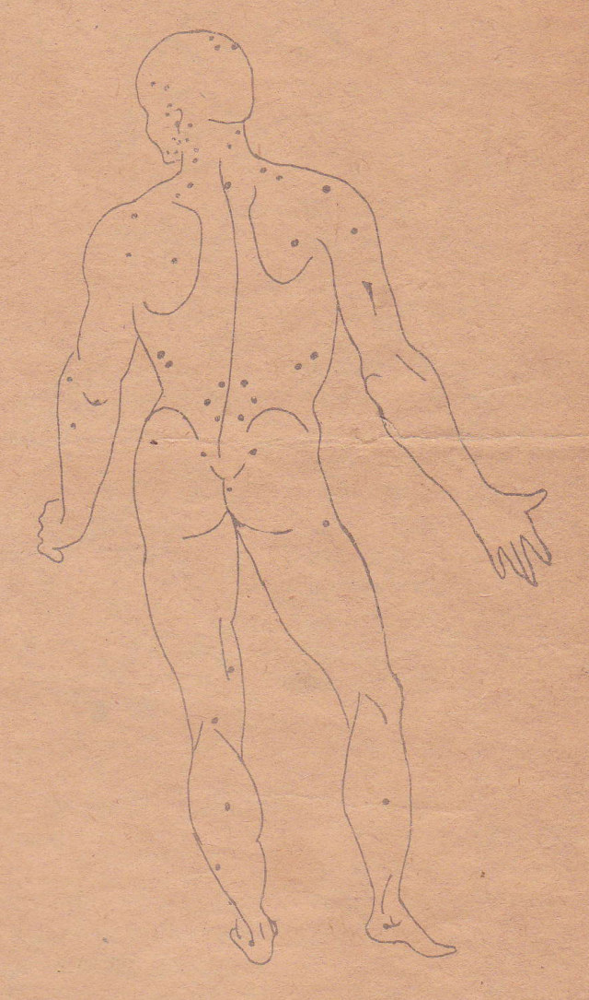
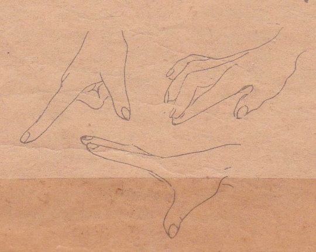

# Вступ — Введение (фрагмент)

Сторінки джерела: 3.

> Сторінки 1–2 книги у скані відсутні, тому вступ починається з середини речення.

…жение указательным или средним пальцем. Это массажное движение.

Для непредвиденного случая каждая семья должна иметь какие-то лечебные сведения, чтобы оказать доврачебную помощь.

Не забывайте, что все люди индивидуальны. Приведенные схемы показывают размещение контактных точек, но так как вы можете быть более худым или более толстым, или иметь другое строение, ваша контактная точка может быть слегка смещена. Это не является проблемой. Даже если вы не знаете название точки или с каким органом она связана, лечите эту болезненную точку; болезненность указывает на то, что энергия утекает, а это необходимо исправить.

Болезни или расстройства, которые вы желаете вылечить, перечислены в указателе в алфавитном порядке с номерами соответствующих контактных точек.

## Как часто надо обрабатывать точки надавливания

Всегда применяйте только такое надавливание, которое вы можете вытерпеть. Нажим на точки должен быть сильным, но не до такой степени, чтобы вызывать острую боль. Помните, что чрезмерно нажимать нельзя. Чем дольше и чаще, тем лучше. Во всех серьезных, острых или хронических случаях обрабатывайте точку в первую неделю ежедневно, затем 2-3 раза в неделю, наконец, один раз в неделю. Это определяется вашими собственными потребностями. Иногда требуется много времени, в другой же раз ваше состояние будет реагировать до невероятности быстро.

## Зведені схеми

*Общая схема тела: вид спереди* (стор. 3)

*Общая схема тела: вид сзади* (стор. 3)

*Положение пальцев при надавливании* (стор. 3)
