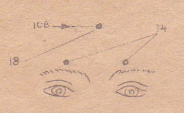

# 10B — СОМАТИЧЕСКАЯ. Глаза, умственные состояния.

**Сегмент:** [Голова — Точки надавливания на голове](_segment.md) · **Джерело:** стор. 6 (PDF стор. 4) · **Соматична точка**

## Опис

Непарная костная выпуклость, которая тянется от виска к виску через центр лобной кости и затем поднимается вверх приблизительно на 5 см над височным соединением с лобной костью. Этот пятисантиметровый участок воздействует на некоторые состояния глаз. Центральная часть поперек лба является соматической и психической, за исключением двух небольших участков, расположенных на кости ("10B") непосредственно над началом каждой брови. Эти два участка лечат затуманенное зрение.

## Зображення

*Лицо: 3M, 2B, 18, 10B, 14M* — малюнок біля опису, стор. 6

*Голова спереди: сводная схема* — зведена схема, стор. 4

*Лоб над бровями: 10B, 18, 34* — зведена схема, стор. 4

## У покажчику («Указатель»)

- Болезнь Аддисона
- Надпочечники
- Головной мозг
- Глаза: затуманенное зрение
- Глаза: дегенерация
- Глаза: слезотечение
- Глаза: психическое состояние
- Глаза: боль
- Бешенство

→ [Повний покажчик](../kody/ukazatel.md)
