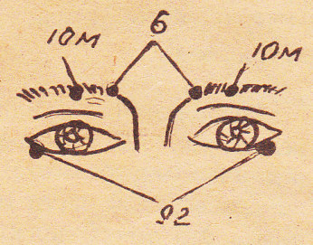
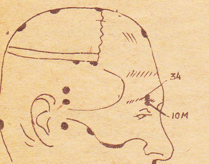
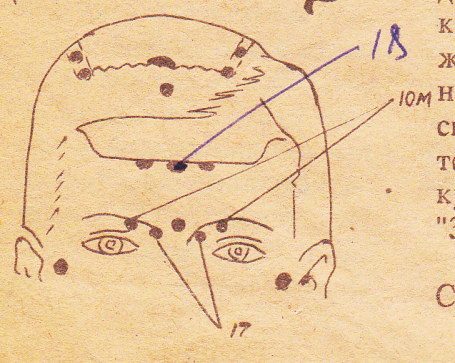
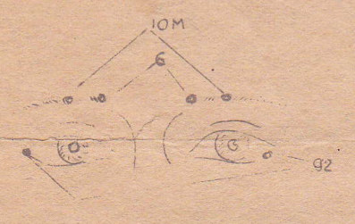

# 10M — СОМАТИЧЕСКАЯ. Мозг, желчный пузырь, печень, плеврит, ишиас.

**Сегмент:** [Голова — Точки надавливания на голове](_segment.md) · **Джерело:** стор. 6 (PDF стор. 4) · **Соматична точка**

## Опис

Это парная точка, расположена в надглазничной выемке под бровями. Надавливание подушечками больших пальцев лечит лобный отдел мозга и оболочки обоих легких (плевру). Они связывают мозг с печенью, желчным пузырем и лечат невралгию седалищного нерва в пояснице и ногах. Имеет большое значение.

## Зображення

*Глаза: 10M, 6, 92* — малюнок біля опису, стор. 6

*Голова сбоку: 34, 10M* — малюнок біля опису, стор. 6

*Голова спереди: 18, 10M, 17* — малюнок біля опису, стор. 6

*Голова сбоку: сводная схема* — зведена схема, стор. 4

*Голова спереди: сводная схема* — зведена схема, стор. 4

*Брови и глаза: точки 10M, 6, 92* — зведена схема, стор. 4

## У покажчику («Указатель»)

- Болезнь Аддисона
- Надпочечники
- Отрыжка
- Разлитие желчи
- Головной мозг
- Ожог
- Переваривание жиров
- Диспепсия
- Боль в бедре
- Расстройство пищеварения
- Желтуха — левая
- Печень
- Легкие
- Брюшина
- Плевра
- Плеврит
- Бешенство
- Ишиас
- Синусы,мозговые
- Синусы,лобные

→ [Повний покажчик](../kody/ukazatel.md)
