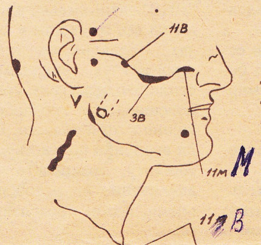
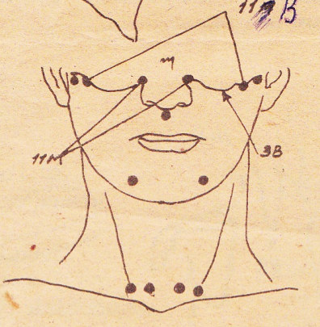

# 11B — Инфекция.

**Сегмент:** [Голова — Точки надавливания на голове](_segment.md) · **Джерело:** стор. 7 (PDF стор. 5)

## Опис

Внимательно проверьте по схеме эти парные точки, расположенные на задней части скул. Болезненность этих точек может указывать на то, что где-то в голове или в теле имеется инфекция.

## Рукописні нотатки власника

- Від руки під заголовком: «алергия».

## Зображення

*Голова сбоку: 11B, 3B, 11M* — малюнок біля опису, стор. 7

*Лицо спереди: 11B, 3B, 11M* — малюнок біля опису, стор. 7

*Голова сбоку: сводная схема* — зведена схема, стор. 4

*Голова спереди: сводная схема* — зведена схема, стор. 4

## У покажчику («Указатель»)

- Болезнь Аддисона
- Цистит
- Дифтерия
- Дивертикул
- Глаза: инфекция
- Желчные камни
- Грыжа
- Инфекция
- Слезотечение
- Спинно-мозговые нервы
- Боль: лицо
- Перитонит
- Флебит
- Зубная боль,инфекция

→ [Повний покажчик](../kody/ukazatel.md)
