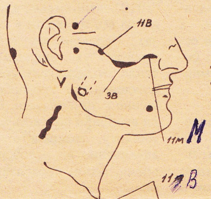
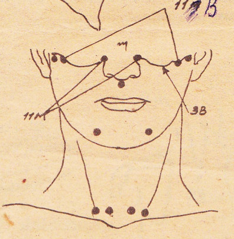

# 11M — Аллергия, бронхи, легкие.

**Сегмент:** [Голова — Точки надавливания на голове](_segment.md) · **Джерело:** стор. 7 (PDF стор. 5)

## Опис

Давите сильно внутрь и вверх на ткань, прилегающую к обеим сторонам носа. Когда вы надавите вверх, вы коснетесь нижней стороны небольшой кости. Это точки "11M", они лечат верхнечелюстные синусы, аллергию и закупорки носа. Они связывают мозг с мелкими бронхами и легкими.

## Рукописні нотатки власника

- В покажчику дописано від руки: «алергия, 11M».

## Зображення

*Голова сбоку: 11B, 3B, 11M* — малюнок біля опису, стор. 7

*Лицо спереди: 11B, 3B, 11M* — малюнок біля опису, стор. 7

*Голова сбоку: сводная схема* — зведена схема, стор. 4

*Голова спереди: сводная схема* — зведена схема, стор. 4

## У покажчику («Указатель»)

- Болезнь Аддисона
- Аденоиды
- Дыхание
- Бронхи
- Кашель
- Диафрагма
- Лихорадка
- Отравление фтором
- Сенная лихорадка
- Икота
- Межпозвоночный хрящ
- Слезотечение
- Легкие
- Слизистая
- Нос
- Боль: лицо
- Боль: голова
- Боль: синус
- Боль: зубы
- Диафрагмальный нерв
- Синусы,лобные
- Зубная боль
- алергия (рукописне)

→ [Повний покажчик](../kody/ukazatel.md)
