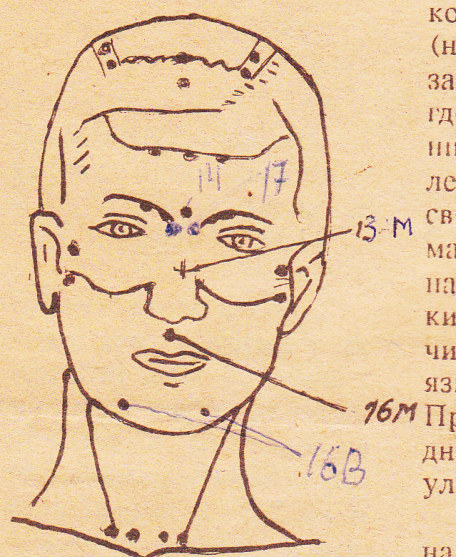
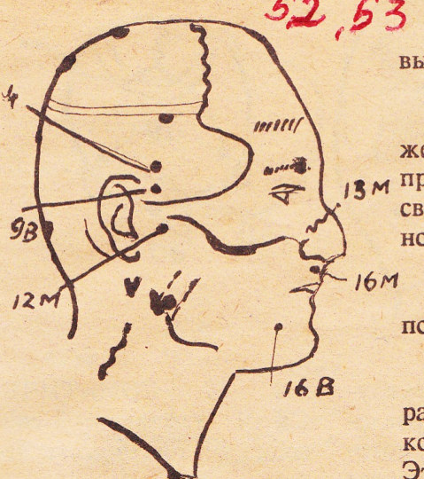

# 13M — Язва 12-перстной кишки, воспаление легких.

**Сегмент:** [Голова — Точки надавливания на голове](_segment.md) · **Джерело:** стор. 6 (PDF стор. 4)

## Опис

Расположена в середине носа, где кончается кость и начинается хрящ (непарная точка). Лечит затылочную долю мозга, где начинается пневмония, прежде чем перейти в легкие. Эта точка также связана с первыми 12 дюймами небольшой кишки, называемой 12-перстной кишкой. Точка "13M" лечит воспаление легких или язву 12-перстной кишки. При язве давить надо ежедневно, пока не наступит улучшение.

## Зображення

*Лицо: 13M, 16M (от руки: 14, 17, 16B)* — малюнок біля опису, стор. 6

*Голова сбоку: 4, 9B, 12M, 13M, 16M, 16B* — малюнок біля опису, стор. 7

*Голова сбоку: сводная схема* — зведена схема, стор. 4

## У покажчику («Указатель»)

- Язва 12-перстной кишки
- 12-перстная кишка
- Кишечник
- Легкие
- Операция,пневмония
- Пневмония

→ [Повний покажчик](../kody/ukazatel.md)
