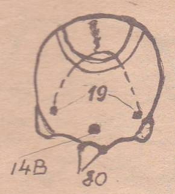
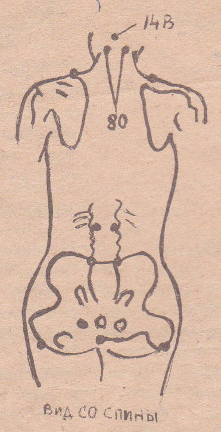

# 14B — Расстройство желудка, паралич.

**Сегмент:** [Голова — Точки надавливания на голове](_segment.md) · **Джерело:** стор. 8 (PDF стор. 6)

## Опис

Задненижняя затылочная выпуклость на задней стороне черепа в середине. Связана с продолговатым мозгом и лечит паралич. Связывает также мозг с поджелудочной железой и является точкой, о которой надо подумать в первую очередь при метеоризме и расстройстве желудка.

## Зображення

*Затылок: 19, 14B, 80* — малюнок біля опису, стор. 8

*Вид со спины: 14B, 80* — малюнок біля опису, стор. 8

*Голова сбоку: сводная схема* — зведена схема, стор. 4

*Затылок: 9M, 2B, 19, 14B, 80* — зведена схема, стор. 4

## У покажчику («Указатель»)

- Повышенная кислотность
- Накопление щелочей
- Кровяное давление, низкое
- Диабет
- Переваривание сахара
- Диспепсия
- Глаза: минеральное равновесие
- Стопа
- Метеоризм
- Подагра
- Соляная кислота
- Сердце: пищеварительные причины
- Расстройство пищеварения
- Инсулин
- Минералы
- Боль: поджелудочная железа
- Поджелудочная железа
- Сахар
- Таламус

→ [Повний покажчик](../kody/ukazatel.md)
