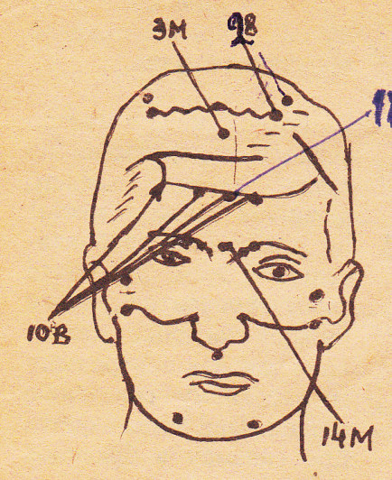

# 14M — Глаза, ноги, желудок.

**Сегмент:** [Голова — Точки надавливания на голове](_segment.md) · **Джерело:** стор. 6 (PDF стор. 4)

## Опис

Область между бровями у корня носа. Имеет шишковидную форму и связана с глазными проблемами и дисфункциями желудка и нижней части ног.

## Зображення

*Лицо: 3M, 2B, 18, 10B, 14M* — малюнок біля опису, стор. 6

*Лицо: 13M, 16M (от руки: 14, 17, 16B)* — малюнок біля опису, стор. 6

*Голова сбоку: сводная схема* — зведена схема, стор. 4

*Голова спереди: сводная схема* — зведена схема, стор. 4

## У покажчику («Указатель»)

- Язва 12-перстной кишки
- 12-перстная кишка
- Кишечник
- Шишковидная железа

→ [Повний покажчик](../kody/ukazatel.md)
