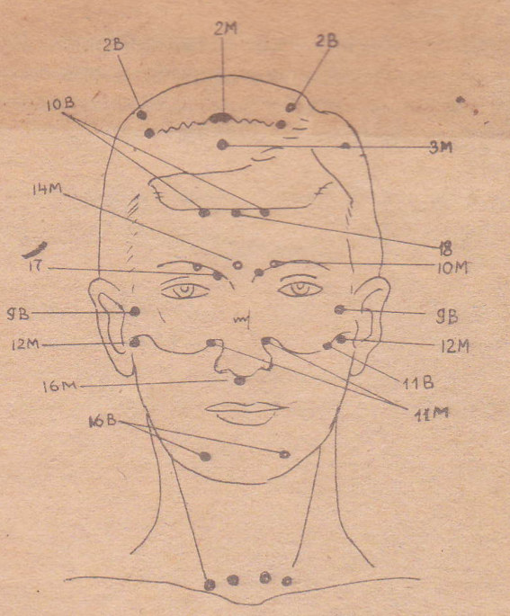

# 16M — Античихательная, паралич.

**Сегмент:** [Голова — Точки надавливания на голове](_segment.md) · **Джерело:** стор. 6 (PDF стор. 4)

## Опис

Непарная точка, расположена под центром носа. Она связана с передней долей гипофиза и лечит некоторые виды параличей. Это также античихательный центр.

## Зображення

*Лицо: 13M, 16M (от руки: 14, 17, 16B)* — малюнок біля опису, стор. 6

*Голова сбоку: 4, 9B, 12M, 13M, 16M, 16B* — малюнок біля опису, стор. 7

*Голова сбоку: сводная схема* — зведена схема, стор. 4

*Голова спереди: сводная схема* — зведена схема, стор. 4

## У покажчику («Указатель»)

- Подагра
- Гипофиз

→ [Повний покажчик](../kody/ukazatel.md)
