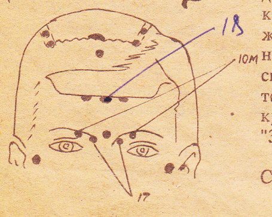
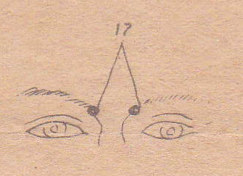

# 17 — Чрезмерное напряжение глаз, желудок.

**Сегмент:** [Голова — Точки надавливания на голове](_segment.md) · **Джерело:** стор. 6 (PDF стор. 4)

## Опис

Точки для лечения чрезмерного напряжения глаз. Расположены по обеим сторонам переносицы. Подушечками больших пальцев скользите под бровями до этой точки и давите вверх. Любой болезненный участок в этой области можно обработать своим большим пальцем. Чрезмерное напряжение глаз - это одна из наиболее распространенных причин головных болей. Точки "17" лечат также желудок.

## Зображення

*Лицо: 13M, 16M (от руки: 14, 17, 16B)* — малюнок біля опису, стор. 6

*Голова спереди: 18, 10M, 17* — малюнок біля опису, стор. 6

*Голова спереди: сводная схема* — зведена схема, стор. 4

*Переносица: точки 17* — зведена схема, стор. 4

## У покажчику («Указатель»)

- Глаза: катаракта
- Глаза: боль
- Глаза: напряжение
- Голова: боль
- Мигрень
- Боль: глаза
- Боль: голова

→ [Повний покажчик](../kody/ukazatel.md)
