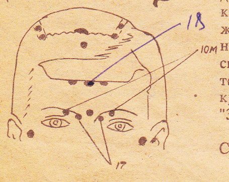
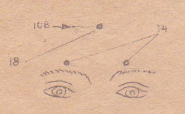

# 18 — Гипофиз.

**Сегмент:** [Голова — Точки надавливания на голове](_segment.md) · **Джерело:** стор. 6 (PDF стор. 4)

## Опис

Это главная головная точка гипофиза, расположена между точками ["10B"](10B.md) в самом центре лба. Гипофиз играет главную роль в химических процессах тела. Когда эта железа переполнена кровью, боль в этой точке наиболее сильная. Нажимайте точки "18" и ["21"](../04-spyna/21.md) (см. стр. 6, 15) одновременно.

## Зображення

*Лицо: 3M, 2B, 18, 10B, 14M* — малюнок біля опису, стор. 6

*Голова спереди: 18, 10M, 17* — малюнок біля опису, стор. 6

*Голова спереди: сводная схема* — зведена схема, стор. 4

*Лоб над бровями: 10B, 18, 34* — зведена схема, стор. 4

## У покажчику («Указатель»)

- Голова: боль
- Мигрень
- Боль: гипофиз
- Гипофиз

→ [Повний покажчик](../kody/ukazatel.md)
