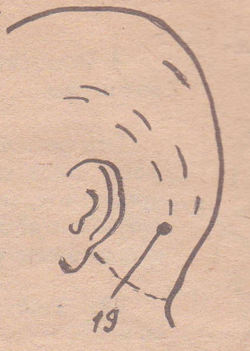
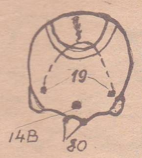
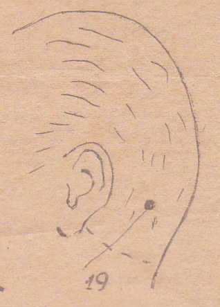

# 19 — СОМАТИЧЕСКАЯ. Умственные способности, токсичность, вены.

**Сегмент:** [Голова — Точки надавливания на голове](_segment.md) · **Джерело:** стор. 8 (PDF стор. 6) · **Соматична точка**

## Опис

Небольшая впадинка над сосцевидным отростком височной кости. Связана с аппетитом, мозгом, токсичностью и закупоркой вен.

## Зображення

*Точка 19 за ухом* — малюнок біля опису, стор. 8

*Затылок: 19, 14B, 80* — малюнок біля опису, стор. 8

*Точка 19 за ухом* — зведена схема, стор. 4

*Затылок: 9M, 2B, 19, 14B, 80* — зведена схема, стор. 4

## У покажчику («Указатель»)

- Аппетит плохой
- Головной мозг
- Глаза: катаракта

→ [Повний покажчик](../kody/ukazatel.md)
