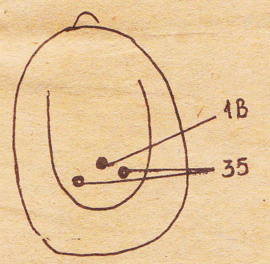
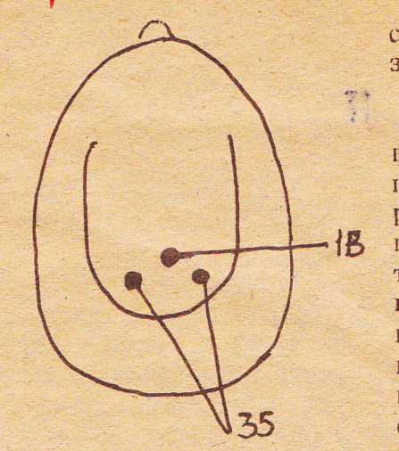
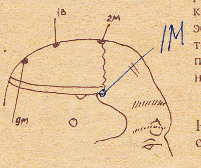

# 1B — Нервное сплетение сердца, привратниковая заслонка желудка.

**Сегмент:** [Голова — Точки надавливания на голове](_segment.md) · **Джерело:** стор. 5 (PDF стор. 3) · **Соматична точка**

## Опис

Расположена в центре верхней части темени на голове впереди заднего родничка (мягкого места) на расстоянии приблизительно 2,5 см. Эта точка ведет к привратнику или к нижней заслонке желудка, а также к центральному нервному сплетению сердца. Она используется при спазмах в брюшной полости, метеоризме и расстройстве желудка. Некоторые люди чувствуют эффект от обработки этой точки во всем теле в виде покалывания от головы до ног.

## Зображення

*Точки 1B и 35, вид сверху* — малюнок біля опису, стор. 5

*Точки 1B и 35, вид сверху* — малюнок біля опису, стор. 5

*Точка 1M, вид сбоку* — малюнок біля опису, стор. 5

*Голова сбоку: сводная схема* — зведена схема, стор. 4

## У покажчику («Указатель»)

- Спазмы в брюшной полости
- Аппетит плохой
- Отрыжка
- Тело, слишком холодное
- Простуда
- Спазмы в животе
- Энергия
- Метеоризм
- Сердце: нервы
- Расстройство пищеварения
- Привратник желудка
- Желудок
- Язва привратника желудка

→ [Повний покажчик](../kody/ukazatel.md)
