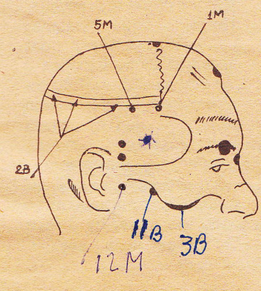
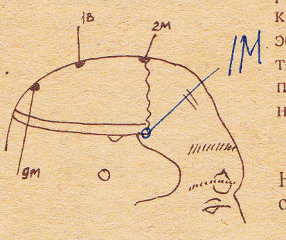

# 1M — Двойное зрение, кишечник.

**Сегмент:** [Голова — Точки надавливания на голове](_segment.md) · **Джерело:** стор. 5 (PDF стор. 3)

## Опис

Расположены на переднем крае височных костей, где они соединяются с лобной костью, по обеим сторонам головы. Чувствительность или боль в этих точках означает расстройство черепно-мозговых нервов. Этими точками мы лечим состояние, называемое диплопией, или двойным зрением. Они также ведут к кишечнику.

## Зображення

*Точки 5M и 1M, вид сбоку (от руки подписаны 12M, 11B, 3B)* — малюнок біля опису, стор. 5

*Точка 1M, вид сбоку* — малюнок біля опису, стор. 5

*Голова сбоку: сводная схема* — зведена схема, стор. 4

## У покажчику («Указатель»)

- Атаксия
- Черепно-мозговые нервы
- Глухота
- Уши
- Глаза: диплопия
- Глаза: нервы
- Психика
- Зрительные нервы

→ [Повний покажчик](../kody/ukazatel.md)
