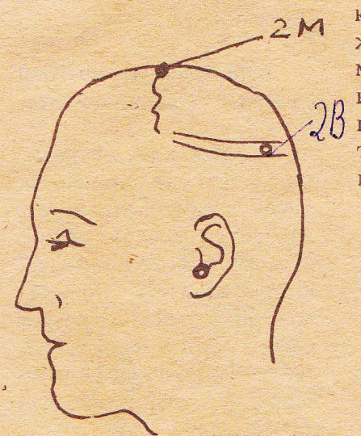
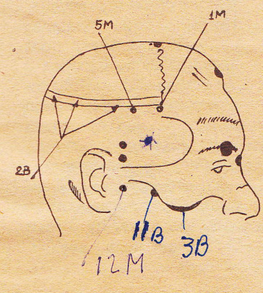
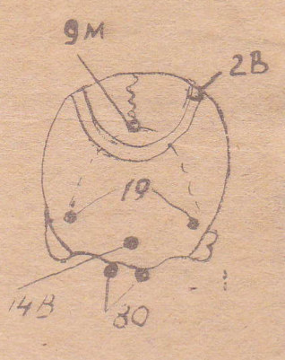
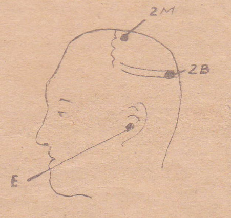

# 2B — СИЛЬВИЕВА БОРОЗДА. Капиллярная система, коронарные артерии.

**Сегмент:** [Голова — Точки надавливания на голове](_segment.md) · **Джерело:** стор. 5 (PDF стор. 3) · **Соматична точка**

## Опис

Кость в форме подковы называется сильвиевой бороздой. Любая точка на этой кости лечит какую-то часть капиллярной системы. Область выше и за левым ухом лечит коронарные артерии сердца, а также все капилляры легких. Передняя точка лечит глаза и голосовые связки. Очень важная.

## Зображення

*Точки 2M и 2B, вид сбоку* — малюнок біля опису, стор. 5

*Точки 5M и 1M, вид сбоку (от руки подписаны 12M, 11B, 3B)* — малюнок біля опису, стор. 5

*Лицо: 3M, 2B, 18, 10B, 14M* — малюнок біля опису, стор. 6

*Голова спереди: сводная схема* — зведена схема, стор. 4

*Затылок: 9M, 2B, 19, 14B, 80* — зведена схема, стор. 4

*Голова сбоку: 2M, 2B, E* — зведена схема, стор. 4

## У покажчику («Указатель»)

- Спайки
- Антибиотики
- Потеря голоса
- Астма — левая (на коронарной точке)
- Кровотечение
- Кровяное давление,высокое
- Кровь в моче
- Кровоподтек,синяк
- Капилляры
- Кровообращение
- Венечная артерия
- Глаза: острый конъюнктивит
- Голова: травма
- Сердце: кровообращение — левая
- Сердце: венечный — левая
- Хрипоты
- Гортань
- Легкие — левая
- Носовое кровотечение
- Боль: зубы
- Зубная боль
- Голосовые связки
- Голос

→ [Повний покажчик](../kody/ukazatel.md)
