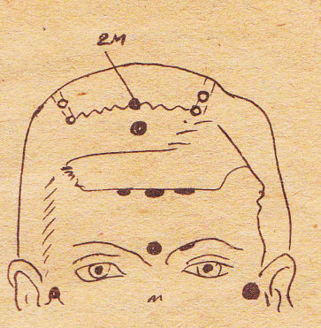
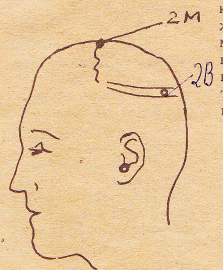
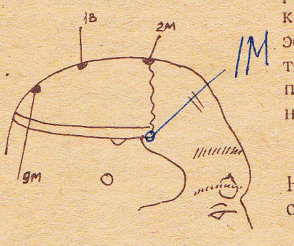
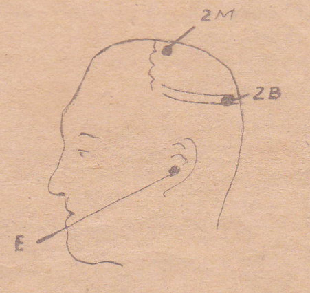

# 2M — ПЕРЕДНИЙ РОДНИЧОК. Сжимающая головная боль

**Сегмент:** [Голова — Точки надавливания на голове](_segment.md) · **Джерело:** стор. 5 (PDF стор. 3)

## Опис

Расположена непосредственно на переднем родничке (мягкое место) в передневерхней части головы. Эта точка должна контролировать черепную жидкость. Если у вас сжимающая головная боль, и вы чувствуете, будто ваша голова разрывается на части, тогда почти всегда помогает точка "2M".

## Зображення

*Точка 2M, вид спереди* — малюнок біля опису, стор. 5

*Точки 2M и 2B, вид сбоку* — малюнок біля опису, стор. 5

*Точка 1M, вид сбоку* — малюнок біля опису, стор. 5

*Голова сбоку: сводная схема* — зведена схема, стор. 4

*Голова спереди: сводная схема* — зведена схема, стор. 4

*Голова сбоку: 2M, 2B, E* — зведена схема, стор. 4

## У покажчику («Указатель»)

- Головной мозг
- Черепно-мозговая жидкость
- Голова: боль
- Голова: давление
- Мигрень
- Боль: голова

→ [Повний покажчик](../kody/ukazatel.md)
