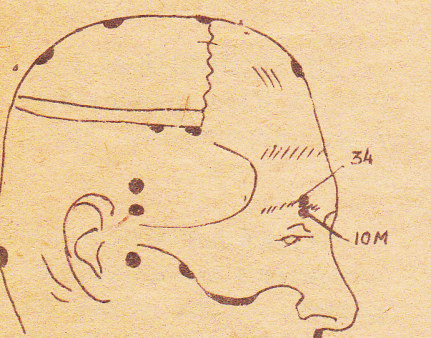
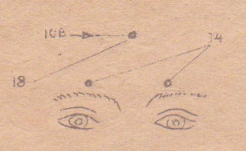

# 34 — Мозг, энергия, пищевое отравление.

**Сегмент:** [Голова — Точки надавливания на голове](_segment.md) · **Джерело:** стор. 6 (PDF стор. 4)

## Опис

Лечит глаза, лобные доли мозга и действует на сознание и кишечник. Эти две точки расположены непосредственно над серединой бровей на лобной кости. Используются также при пищевом отравлении. Если вам захочется спать за рулем машины, в течение нескольких секунд нажимайте на точки "34".

## Зображення

*Голова сбоку: 34, 10M* — малюнок біля опису, стор. 6

*Голова сбоку: сводная схема* — зведена схема, стор. 4

*Лоб над бровями: 10B, 18, 34* — зведена схема, стор. 4

## У покажчику («Указатель»)

- Глаза: сонливость
- Пищевое отравление
- Отравление, пищевое

→ [Повний покажчик](../kody/ukazatel.md)
