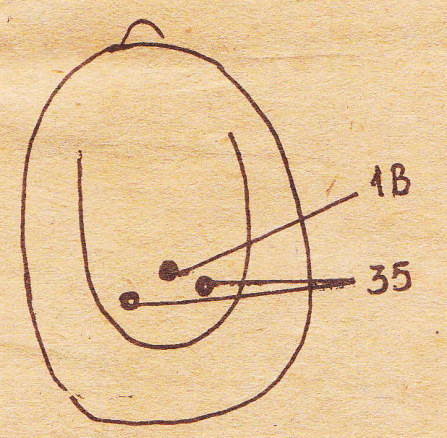
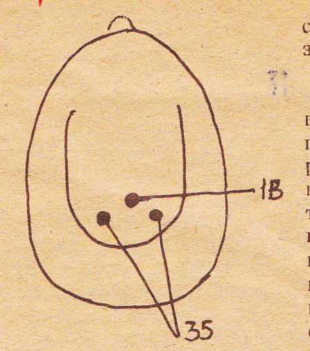

# 35 — СОМАТИЧЕСКАЯ (т.е. относящаяся ко всему организму). МОЗЖЕЧОК.

**Сегмент:** [Голова — Точки надавливания на голове](_segment.md) · **Джерело:** стор. 5 (PDF стор. 3) · **Соматична точка**

## Опис

Эти два центра снимают некоторые типы глазных болей. Они расположены по обеим сторонам от точки ["1B"](1B.md) на расстоянии приблизительно 2,5 см и на 2,5 см позади этой точки. Вместе с точкой ["1B"](1B.md) они напоминают по форме пирамиду.

## Зображення

*Точки 1B и 35, вид сверху* — малюнок біля опису, стор. 5

*Точки 1B и 35, вид сверху* — малюнок біля опису, стор. 5

## У покажчику («Указатель»)

- Глаза: катаракта
- Глаза: боль
- Боль: глаза

→ [Повний покажчик](../kody/ukazatel.md)
