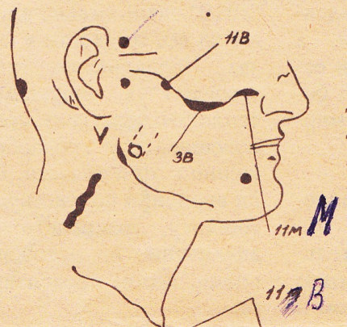
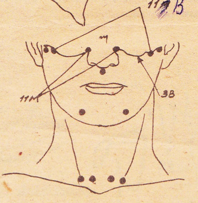

# 3B — Синуситы (воспаление синуситов, т.е. пазух, особенно лобных).

**Сегмент:** [Голова — Точки надавливания на голове](_segment.md) · **Джерело:** стор. 7 (PDF стор. 5)

## Опис

Расположены у нижнего края обеих скул. Имеют отношение к слизистым оболочкам тканей. Проверьте на них лечение синуситов.

## Зображення

*Голова сбоку: 11B, 3B, 11M* — малюнок біля опису, стор. 7

*Лицо спереди: 11B, 3B, 11M* — малюнок біля опису, стор. 7

*Голова сбоку: сводная схема* — зведена схема, стор. 4

## У покажчику («Указатель»)

- Лихорадка
- Отравление фтором
- Слизистая
- Боль: лицо

→ [Повний покажчик](../kody/ukazatel.md)
