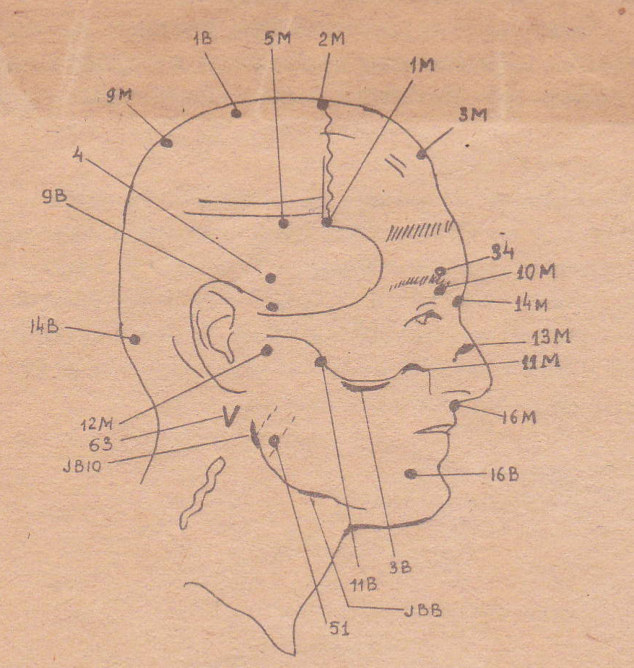

# 4 — Мозг, спинно-мозговые нервы.

**Сегмент:** [Голова — Точки надавливания на голове](_segment.md) · **Джерело:** стор. 7 (PDF стор. 5)

## Опис

Эти две точки расположены выше точек ["12M"](12M.md) приблизительно на 5 см и связаны с мозгом и спинно-мозговыми нервами.

## Зображення

*Голова сбоку: 4, 9B, 12M, 13M, 16M, 16B* — малюнок біля опису, стор. 7

*Голова сбоку: сводная схема* — зведена схема, стор. 4

## У покажчику («Указатель»)

- Головной мозг
- Эмоции
- Голова: боль
- Умопомешательство
- Межпозвоночный хрящ
- Память
- Черепно-мозговые нервы
- Спинно-мозговые нервы
- Нервозность

→ [Повний покажчик](../kody/ukazatel.md)
