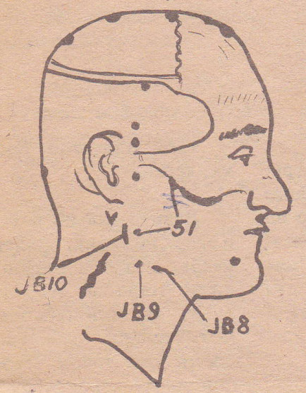

# 51 — Лицевые мышцы, свинка.

**Сегмент:** [Голова — Точки надавливания на голове](_segment.md) · **Джерело:** стор. 8 (PDF стор. 6)

## Опис

Эти 2 точки находятся на жевательных мышцах на нижней челюсти. Воздействует на все лицевые мышцы, глаза и преждевременные морщинки, а также лечит свинку и ослабляет влияние этой болезни на органы размножения.

## Рукописні нотатки власника

- Від руки біля заголовка: «Морщины».

## Зображення

*Голова сбоку: 51, JB10, JB9, JB8* — малюнок біля опису, стор. 8

*Голова сбоку: сводная схема* — зведена схема, стор. 4

## У покажчику («Указатель»)

- Лихорадка
- Слезотечение
- Рот
- Свинка
- Свинка в половых органах
- Нос
- Боль: лицо

→ [Повний покажчик](../kody/ukazatel.md)
