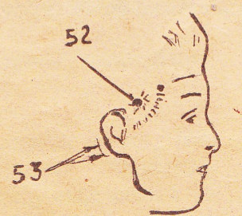
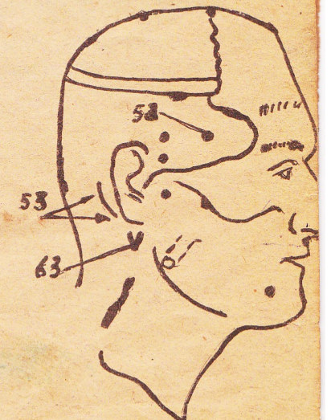
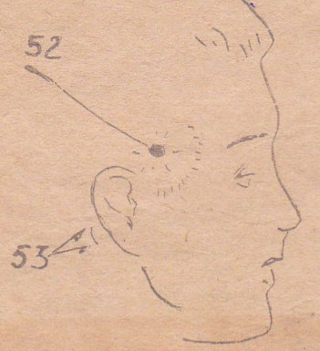

# 52 — Брюшная полость, избыточная жидкость, глаза, сердце, легкие, желудок.

**Сегмент:** [Голова — Точки надавливания на голове](_segment.md) · **Джерело:** стор. 7 (PDF стор. 5)

## Опис

В самом центре виска находится мягкое место, как-будто бы здесь отверстие в мозг. Нащупайте болезненную точку, даже если она не совсем в центре этого очень маленького кажущегося отверстия. Надавливание в этом месте лечит кишечник, толстую кишку и брюшину, представляющую собой большую мешкообразную ткань, которая закрывает и защищает содержимое брюшной полости. Перитонит - это медицинский термин, означающий инфекцию в брюшине. Лечит также желудок, легкие, сердце, глаза, вздутие живота, а также выводит из организма избыточную жидкость.

## Рукописні нотатки власника

- Від руки над заголовком: «перетонит»; слова «избыточная жидкость» підкреслено.

## Зображення

*Висок: 52, 53* — малюнок біля опису, стор. 7

*Голова сбоку: 52, 53, 63* — малюнок біля опису, стор. 7

*Висок и сосцевидный отросток: 52, 53* — зведена схема, стор. 4

## У покажчику («Указатель»)

- Отек брюшной полости
- Желчный проток
- Дистрофия мышечная
- Фасция
- Кишечник
- Мышцы
- Брюшина
- Перитонит
- Флебит
- Мошонка
- Желудок,эмоциональный

→ [Повний покажчик](../kody/ukazatel.md)
