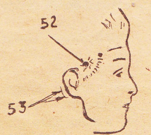
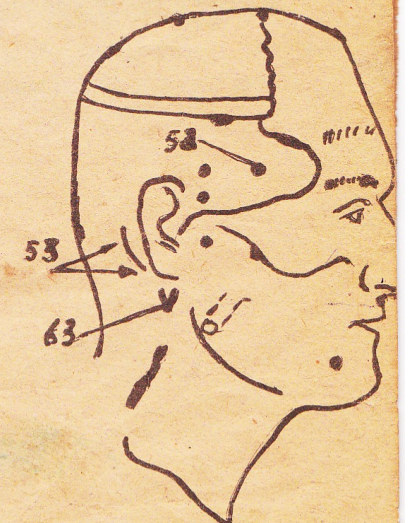
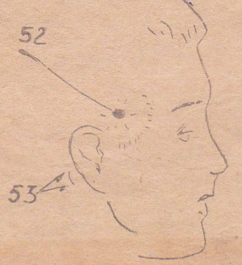

# 53 — Сосцевидный отросток височной кости. Уши, кишечник.

**Сегмент:** [Голова — Точки надавливания на голове](_segment.md) · **Джерело:** стор. 7 (PDF стор. 5)

## Опис

Если приложить пальцы позади уха, можно нащупать маленькую косточку. Она называется мастоидом. Нажмите на нее снизу, нажмите еще раз, а затем немножко сбоку - это окажет воздействие на работу кишечника, толстую кишку и на уши.

## Зображення

*Висок: 52, 53* — малюнок біля опису, стор. 7

*Голова сбоку: 52, 53, 63* — малюнок біля опису, стор. 7

*Висок и сосцевидный отросток: 52, 53* — зведена схема, стор. 4

## У покажчику («Указатель»)

- Толстая кишка
- Глухота
- Уши

→ [Повний покажчик](../kody/ukazatel.md)
