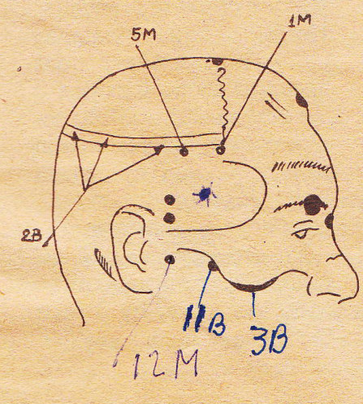

# 5M — Эмоциональный центр мозга.

**Сегмент:** [Голова — Точки надавливания на голове](_segment.md) · **Джерело:** стор. 5 (PDF стор. 3) · **Соматична точка**

## Опис

Расположены ниже сильвиевой борозды (["2B"](2B.md)), но все же касаются ее в том месте, где теменные кости встречаются с лобными костями по обеим сторонам головы. Точки "5M" лечат эмоциональный центр мозга. Обработка этих точек обычно помогает ослабить одни типы головной боли и совершенно устранить другие. Должна производиться только под наблюдением врача.

## Зображення

*Точки 5M и 1M, вид сбоку (от руки подписаны 12M, 11B, 3B)* — малюнок біля опису, стор. 5

*Голова сбоку: сводная схема* — зведена схема, стор. 4

## У покажчику («Указатель»)

- Головной мозг
- Эмоции
- Печальное настроение
- Голова: боль
- Сердце: эмоциональные
- Умопомешательство
- Память
- Психика
- Мигрень
- Нервозность
- Боль: голова

→ [Повний покажчик](../kody/ukazatel.md)
