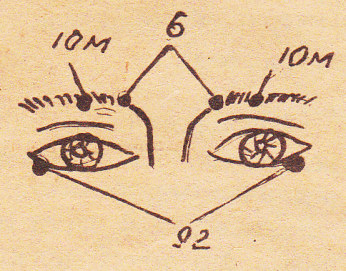
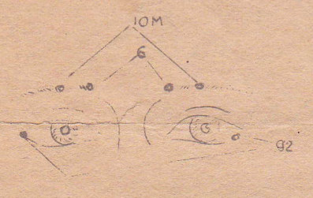

# 6 — Мозг, синусы.

**Сегмент:** [Голова — Точки надавливания на голове](_segment.md) · **Джерело:** стор. 6 (PDF стор. 4)

## Опис

Это парная точка, расположена на переднем крае надглазничной кости по обеим сторонам корня носа, лечит все синусы (т.е. пазухи), а также мозг.

## Зображення

*Глаза: 10M, 6, 92* — малюнок біля опису, стор. 6

*Брови и глаза: точки 10M, 6, 92* — зведена схема, стор. 4

## У покажчику («Указатель»)

- Лихорадка
- Отравление фтором
- Голова: боль
- Мигрень
- Слизистая
- Боль: голова
- Боль: синус
- Синусы,мозговые

→ [Повний покажчик](../kody/ukazatel.md)
