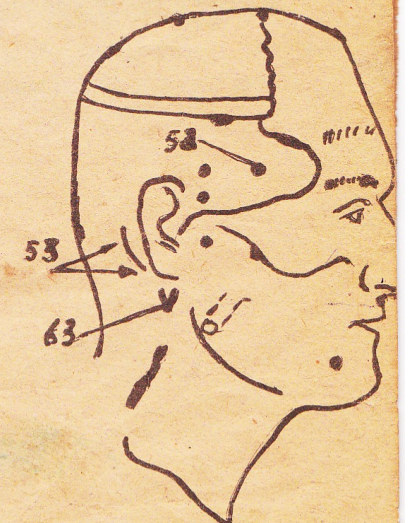
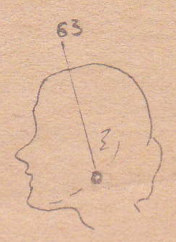

# 63 — Амнезия (потеря памяти).

**Сегмент:** [Голова — Точки надавливания на голове](_segment.md) · **Джерело:** стор. 7 (PDF стор. 5) · **Соматична точка**

## Опис

Расположена на конце шиловидной кости - давите под ухом. Эта точка в некоторых случаях влияет на мозг. Может быть показана в случаях амнезии.

## Зображення

*Голова сбоку: 52, 53, 63* — малюнок біля опису, стор. 7

*Голова сбоку: сводная схема* — зведена схема, стор. 4

*Точка 63 под ухом* — зведена схема, стор. 4

## У покажчику («Указатель»)

- Амнезия
- Глухота
- Уши
- Глаза: катаракта

→ [Повний покажчик](../kody/ukazatel.md)
