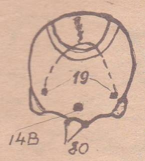
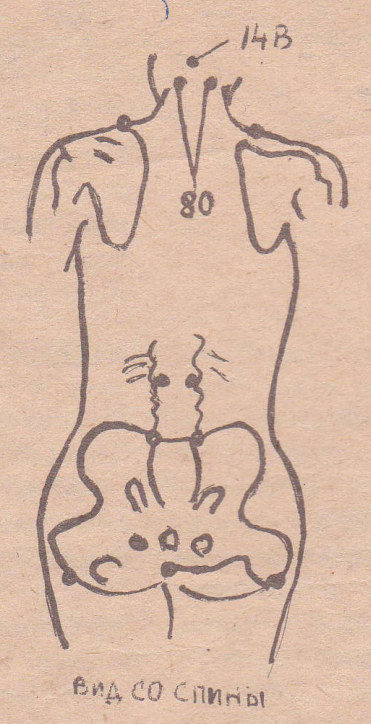

# 80 — Головные боли, носовые кровотечения, селезенка.

**Сегмент:** [Голова — Точки надавливания на голове](_segment.md) · **Джерело:** стор. 8 (PDF стор. 6)

## Опис

Расположены под основанием черепа по обеим сторонам от середины. Связывает мозг с селезенкой, лечит головные и глазные боли, а также носовые кровотечения. Примечание: носовые кровотечения могут указывать на болезнь селезенки.

## Зображення

*Затылок: 19, 14B, 80* — малюнок біля опису, стор. 8

*Вид со спины: 14B, 80* — малюнок біля опису, стор. 8

*Затылок: 9M, 2B, 19, 14B, 80* — зведена схема, стор. 4

## У покажчику («Указатель»)

- Анемия
- Потеря голоса
- Глаза: дегенерация
- Носовое кровотечение
- Боль: селезенка
- Селезенка
- Голос

→ [Повний покажчик](../kody/ukazatel.md)
