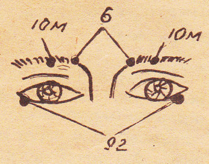
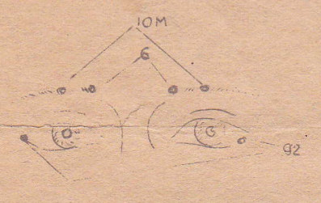

# 92 — Мозг, глаза.

**Сегмент:** [Голова — Точки надавливания на голове](_segment.md) · **Джерело:** стор. 6 (PDF стор. 4)

## Опис

Небольшая выемка на внешнем нижнем крае кости, окружающей глаза. Лечит глаза и умственные состояния.

## Рукописні нотатки власника

- В покажчику дописано від руки: «Анти інсульт - 92» (з малюнком ока).

## Зображення

*Глаза: 10M, 6, 92* — малюнок біля опису, стор. 6

*Брови и глаза: точки 10M, 6, 92* — зведена схема, стор. 4

## У покажчику («Указатель»)

- Глаза: катаракта
- Глаза: психическое состояние
- Глаза: нервы
- Глаза: сонливость
- Умопомешательство
- Память
- Психика
- Нервозность
- Анти інсульт (рукописне)

→ [Повний покажчик](../kody/ukazatel.md)
