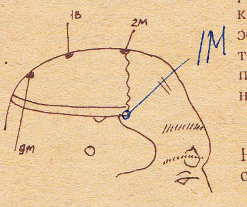
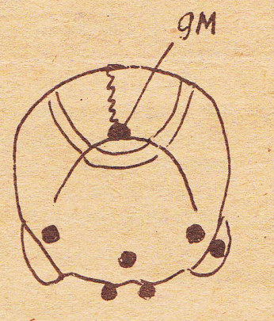

# 9M — ЗАДНИЙ РОДНИЧОК. Мозг, энергия, одутловатость.

**Сегмент:** [Голова — Точки надавливания на голове](_segment.md) · **Джерело:** стор. 5 (PDF стор. 3)

## Опис

Расположена на заднем родничке, уравновешивает энергию между гипофизом и шишковидной железой. Отсюда энергия перемещается вниз к спинному мозгу. Лечит мозг, толстую кишку, отекшие ноги, одутловатость, а также выводит из организма избыточную жидкость. Имеет большое значение.

## Зображення

*Точка 1M, вид сбоку* — малюнок біля опису, стор. 5

*Точка 9M, вид сзади* — малюнок біля опису, стор. 5

*Голова сбоку: сводная схема* — зведена схема, стор. 4

*Затылок: 9M, 2B, 19, 14B, 80* — зведена схема, стор. 4

## У покажчику («Указатель»)

- Отек брюшной полости
- Кровяное давление, низкое
- Умопомешательство
- Кровообращение в ногах
- Ноги, увеличенные
- Флебит
- Шишковидная железа
- Гипофиз
- Спинной мозг

→ [Повний покажчик](../kody/ukazatel.md)
