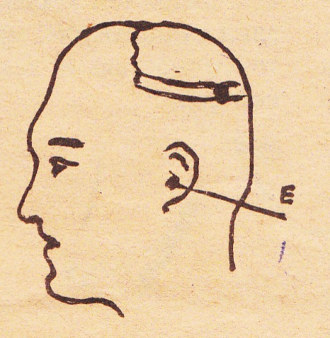
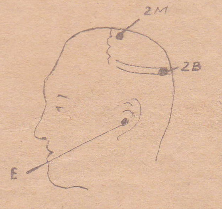

# E — Давление крови.

**Сегмент:** [Голова — Точки надавливания на голове](_segment.md) · **Джерело:** стор. 7 (PDF стор. 5)

## Опис

Обработка ушных отверстий видна из схемы. Давите прямо в ухо, затем слегка вверх по направлению к носу. К этой процедуре будет чувствительно все тело или одни конечности. Давление крови может быть снижено в результате первой же процедуры.

## Зображення

*Обработка уха: E* — малюнок біля опису, стор. 7

*Голова сбоку: 2M, 2B, E* — зведена схема, стор. 4

## У покажчику («Указатель»)

- Кровяное давление,высокое
- Высокое кровяное давление

→ [Повний покажчик](../kody/ukazatel.md)
