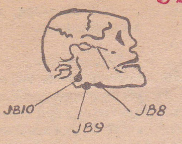
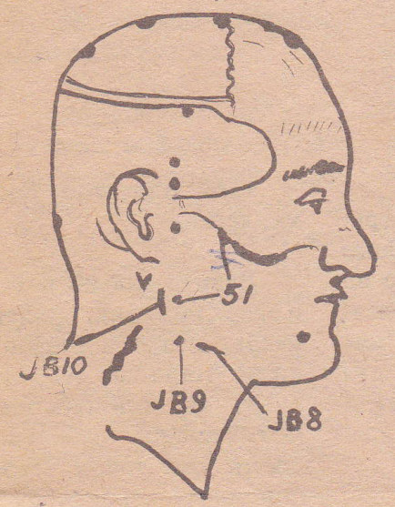
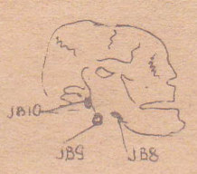

# JB10 — Глаза, отравление.

**Сегмент:** [Голова — Точки надавливания на голове](_segment.md) · **Джерело:** стор. 8 (PDF стор. 6)

## Опис

Положите указательный палец на заднюю часть челюсти под ухом и давите вперед. Во всех случаях глаукомы, отравления, а также люди, которые носят или собираются носить очки с двухфокусными стеклами, почувствуют боль в этих точках. "JB10" очень сильно влияют на все жидкости в глазах. Надавливание здесь приведет к ощущению теплоты позади глаз, уравновешивается кровообращение в этой области. Если временно почувствуете тошноту, прекратите надавливание на некоторое время, потом продолжайте.

## Зображення

*Череп: JB10, JB9, JB8* — малюнок біля опису, стор. 8

*Голова сбоку: 51, JB10, JB9, JB8* — малюнок біля опису, стор. 8

*Голова сбоку: сводная схема* — зведена схема, стор. 4

*Череп сбоку: JB10, JB9, JB8* — зведена схема, стор. 4

## У покажчику («Указатель»)

- Алкоголизм
- Глаза: двухфокусное зрение
- Глаза: катаракта
- Глаза: дегенерация
- Глаза: глаукома
- Глаза: боль
- Глаза: выпученные глаза
- Глаукома
- Слезотечение
- Боль: глаза
- Боль: голова
- Боль: челюсть

→ [Повний покажчик](../kody/ukazatel.md)
