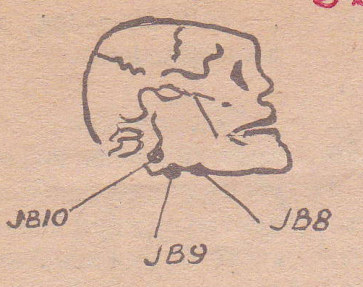
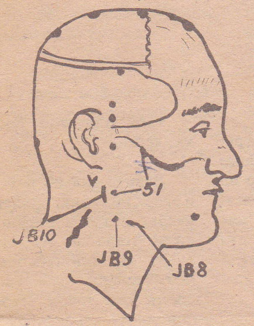
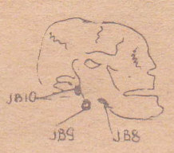

# JB8 — Зубная боль.

**Сегмент:** [Голова — Точки надавливания на голове](_segment.md) · **Джерело:** стор. 8 (PDF стор. 6)

## Опис

Расположена под нижней челюстью и представляет собой бороздку в кости. Щупайте снизу в направлении к спине, пока не нащупаете эту бороздку. Давите при зубной боли.

## Зображення

*Череп: JB10, JB9, JB8* — малюнок біля опису, стор. 8

*Голова сбоку: 51, JB10, JB9, JB8* — малюнок біля опису, стор. 8

*Голова сбоку: сводная схема* — зведена схема, стор. 4

*Череп сбоку: JB10, JB9, JB8* — зведена схема, стор. 4

## У покажчику («Указатель»)

- Боль: лицо
- Боль: зубы
- Зубная боль

→ [Повний покажчик](../kody/ukazatel.md)
