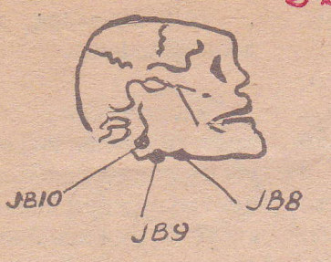
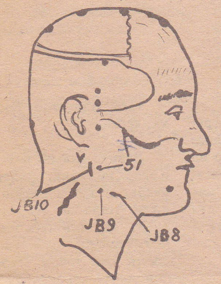
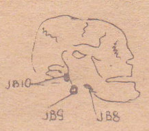

# JB9 — Кишечник.

**Сегмент:** [Голова — Точки надавливания на голове](_segment.md) · **Джерело:** стор. 8 (PDF стор. 6)

## Опис

Лечит толстую кишку и кишечник. Расположена на изгибе челюсти между точками ["JB8"](JB8.md) и ["JB10"](JB10.md).

## Зображення

*Череп: JB10, JB9, JB8* — малюнок біля опису, стор. 8

*Голова сбоку: 51, JB10, JB9, JB8* — малюнок біля опису, стор. 8

*Череп сбоку: JB10, JB9, JB8* — зведена схема, стор. 4

## У покажчику («Указатель»)

- Толстая кишка
- Кишечник

→ [Повний покажчик](../kody/ukazatel.md)
