# Голова — Точки надавливания на голове

Сторінки джерела: 4–8.

## Точки

| Код | Заголовок | Стор. | Малюнків |
|---|---|---|---|
| [2M](2M.md) | ПЕРЕДНИЙ РОДНИЧОК. Сжимающая головная боль | 5 | 6 |
| [35](35.md) | СОМАТИЧЕСКАЯ (т.е. относящаяся ко всему организму). МОЗЖЕЧОК. | 5 | 2 |
| [5M](5M.md) | Эмоциональный центр мозга. | 5 | 2 |
| [1B](1B.md) | Нервное сплетение сердца, привратниковая заслонка желудка. | 5 | 4 |
| [9M](9M.md) | ЗАДНИЙ РОДНИЧОК. Мозг, энергия, одутловатость. | 5 | 4 |
| [1M](1M.md) | Двойное зрение, кишечник. | 5 | 3 |
| [2B](2B.md) | СИЛЬВИЕВА БОРОЗДА. Капиллярная система, коронарные артерии. | 5 | 6 |
| [3M](3M.md) | Головокружение, желудок, трахея. | 6 | 3 |
| [18](18.md) | Гипофиз. | 6 | 4 |
| [10B](10B.md) | СОМАТИЧЕСКАЯ. Глаза, умственные состояния. | 6 | 3 |
| [14M](14M.md) | Глаза, ноги, желудок. | 6 | 4 |
| [6](6.md) | Мозг, синусы. | 6 | 2 |
| [92](92.md) | Мозг, глаза. | 6 | 2 |
| [13M](13M.md) | Язва 12-перстной кишки, воспаление легких. | 6 | 3 |
| [16M](16M.md) | Античихательная, паралич. | 6 | 4 |
| [34](34.md) | Мозг, энергия, пищевое отравление. | 6 | 3 |
| [10M](10M.md) | СОМАТИЧЕСКАЯ. Мозг, желчный пузырь, печень, плеврит, ишиас. | 6 | 6 |
| [17](17.md) | Чрезмерное напряжение глаз, желудок. | 6 | 4 |
| [E](E.md) | Давление крови. | 7 | 2 |
| [4](4.md) | Мозг, спинно-мозговые нервы. | 7 | 2 |
| [9B](9B.md) | Толстая кишка, почки. | 7 | 3 |
| [12M](12M.md) | Атеросклероз, сердце, мышцы, вены. | 7 | 3 |
| [11B](11B.md) | Инфекция. | 7 | 4 |
| [3B](3B.md) | Синуситы (воспаление синуситов, т.е. пазух, особенно лобных). | 7 | 3 |
| [16B](16B.md) | Насморк, задняя доля гипофиза. | 7 | 4 |
| [11M](11M.md) | Аллергия, бронхи, легкие. | 7 | 4 |
| [63](63.md) | Амнезия (потеря памяти). | 7 | 3 |
| [52](52.md) | Брюшная полость, избыточная жидкость, глаза, сердце, легкие, желудок. | 7 | 3 |
| [53](53.md) | Сосцевидный отросток височной кости. Уши, кишечник. | 7 | 3 |
| [JB8](JB8.md) | Зубная боль. | 8 | 4 |
| [JB9](JB9.md) | Кишечник. | 8 | 3 |
| [51](51.md) | Лицевые мышцы, свинка. | 8 | 2 |
| [JB10](JB10.md) | Глаза, отравление. | 8 | 4 |
| [19](19.md) | СОМАТИЧЕСКАЯ. Умственные способности, токсичность, вены. | 8 | 4 |
| [14B](14B.md) | Расстройство желудка, паралич. | 8 | 4 |
| [80](80.md) | Головные боли, носовые кровотечения, селезенка. | 8 | 3 |

## Рукописні переліки точок угорі сторінок (червоним)

- стор. 5: 2M, 35, 5M, 1M, 1B, 9M, 2B
- стор. 6: 3M, 18, 10B, 14M, 6, 92, 13(M), 16(M), 34, 10M, 17
- стор. 7: E, 4, 9B, 12M, 11B, 3B, 16B, 11M, 63, 52, 53
- стор. 8: JB8, 14B, JB9, 51, JB10, 19, 80

## Зведені схеми

*Голова сбоку: сводная схема* (стор. 4) — точки: [1B](1B.md), [5M](5M.md), [2M](2M.md), [1M](1M.md), [3M](3M.md), [9M](9M.md), [4](4.md), [9B](9B.md), [34](34.md), [10M](10M.md), [14M](14M.md), [13M](13M.md), [11M](11M.md), [16M](16M.md), [16B](16B.md), [14B](14B.md), [12M](12M.md), [63](63.md), [JB10](JB10.md), [JB8](JB8.md), [51](51.md), [3B](3B.md), [11B](11B.md)

*Голова спереди: сводная схема* (стор. 4) — точки: [2B](2B.md), [2M](2M.md), [3M](3M.md), [10B](10B.md), [14M](14M.md), [18](18.md), [10M](10M.md), [17](17.md), [9B](9B.md), [12M](12M.md), [16M](16M.md), [16B](16B.md), [11B](11B.md), [11M](11M.md)

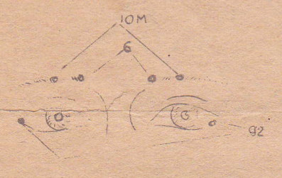

*Брови и глаза: точки 10M, 6, 92* (стор. 4) — точки: [10M](10M.md), [6](6.md), [92](92.md)

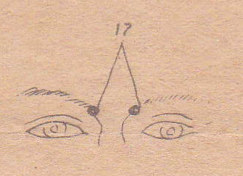

*Переносица: точки 17* (стор. 4) — точки: [17](17.md)

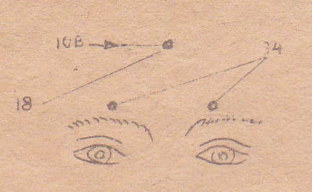

*Лоб над бровями: 10B, 18, 34* (стор. 4) — точки: [10B](10B.md), [18](18.md), [34](34.md)

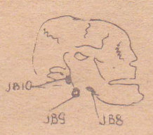

*Череп сбоку: JB10, JB9, JB8* (стор. 4) — точки: [JB10](JB10.md), [JB9](JB9.md), [JB8](JB8.md)

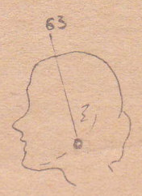

*Точка 63 под ухом* (стор. 4) — точки: [63](63.md)

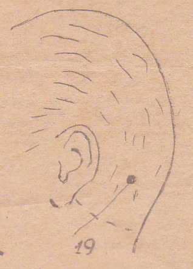

*Точка 19 за ухом* (стор. 4) — точки: [19](19.md)

*Затылок: 9M, 2B, 19, 14B, 80* (стор. 4) — точки: [9M](9M.md), [2B](2B.md), [19](19.md), [14B](14B.md), [80](80.md)

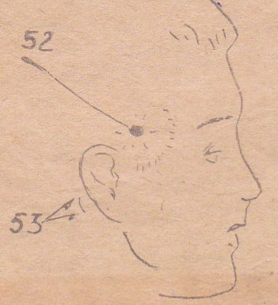

*Висок и сосцевидный отросток: 52, 53* (стор. 4) — точки: [52](52.md), [53](53.md)

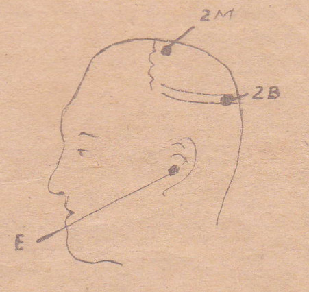

*Голова сбоку: 2M, 2B, E* (стор. 4) — точки: [2M](2M.md), [2B](2B.md), [E](E.md)

## Малюнки біля описів

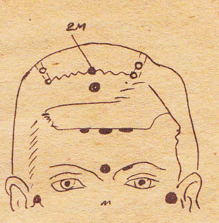

*Точка 2M, вид спереди* (стор. 5) — точки: [2M](2M.md)

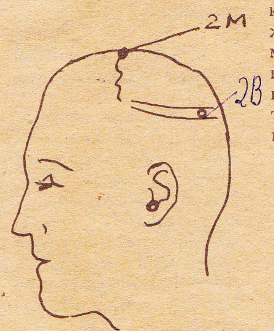

*Точки 2M и 2B, вид сбоку* (стор. 5) — точки: [2M](2M.md), [2B](2B.md)

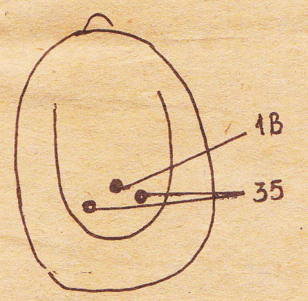

*Точки 1B и 35, вид сверху* (стор. 5) — точки: [1B](1B.md), [35](35.md)

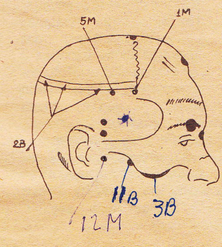

*Точки 5M и 1M, вид сбоку (от руки подписаны 12M, 11B, 3B)* (стор. 5) — точки: [5M](5M.md), [1M](1M.md), [2B](2B.md)

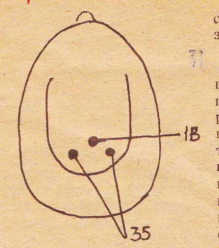

*Точки 1B и 35, вид сверху* (стор. 5) — точки: [1B](1B.md), [35](35.md)

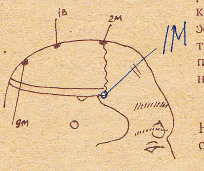

*Точка 1M, вид сбоку* (стор. 5) — точки: [1M](1M.md), [1B](1B.md), [2M](2M.md), [9M](9M.md)

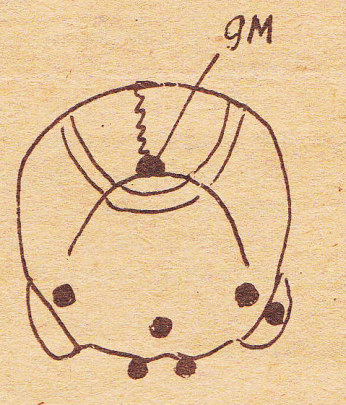

*Точка 9M, вид сзади* (стор. 5) — точки: [9M](9M.md)

*Лицо: 3M, 2B, 18, 10B, 14M* (стор. 6) — точки: [3M](3M.md), [2B](2B.md), [18](18.md), [10B](10B.md), [14M](14M.md)

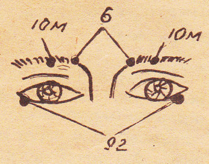

*Глаза: 10M, 6, 92* (стор. 6) — точки: [10M](10M.md), [6](6.md), [92](92.md)

*Лицо: 13M, 16M (от руки: 14, 17, 16B)* (стор. 6) — точки: [13M](13M.md), [16M](16M.md), [16B](16B.md), [14M](14M.md), [17](17.md)

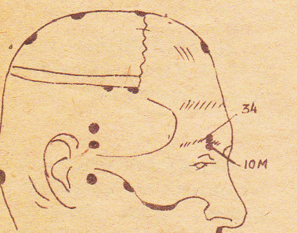

*Голова сбоку: 34, 10M* (стор. 6) — точки: [34](34.md), [10M](10M.md)

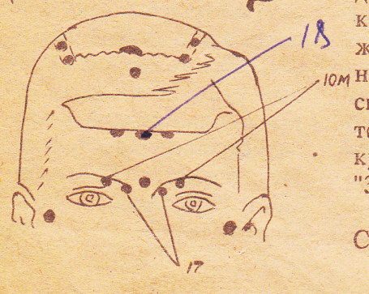

*Голова спереди: 18, 10M, 17* (стор. 6) — точки: [18](18.md), [10M](10M.md), [17](17.md)

*Голова сбоку: 4, 9B, 12M, 13M, 16M, 16B* (стор. 7) — точки: [4](4.md), [9B](9B.md), [12M](12M.md), [13M](13M.md), [16M](16M.md), [16B](16B.md)

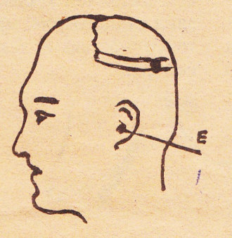

*Обработка уха: E* (стор. 7) — точки: [E](E.md)

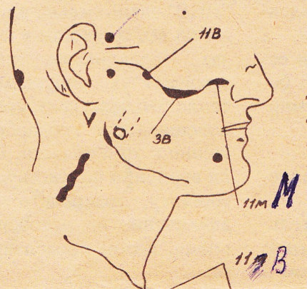

*Голова сбоку: 11B, 3B, 11M* (стор. 7) — точки: [11B](11B.md), [3B](3B.md), [11M](11M.md)

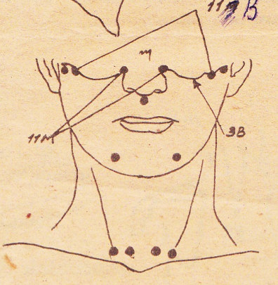

*Лицо спереди: 11B, 3B, 11M* (стор. 7) — точки: [11B](11B.md), [3B](3B.md), [11M](11M.md)

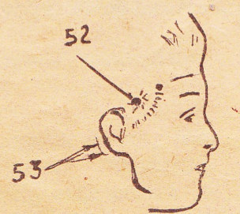

*Висок: 52, 53* (стор. 7) — точки: [52](52.md), [53](53.md)

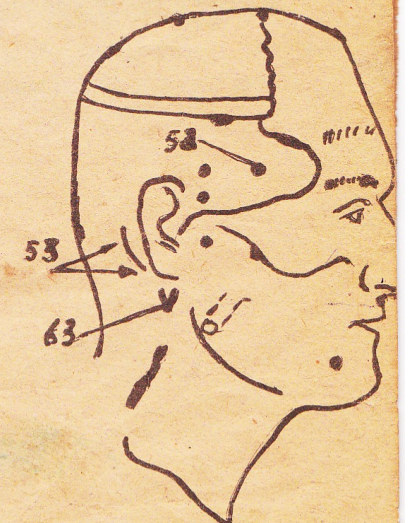

*Голова сбоку: 52, 53, 63* (стор. 7) — точки: [52](52.md), [53](53.md), [63](63.md)

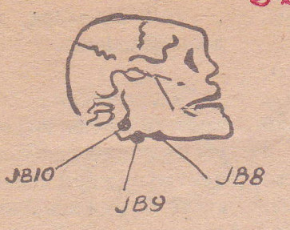

*Череп: JB10, JB9, JB8* (стор. 8) — точки: [JB10](JB10.md), [JB9](JB9.md), [JB8](JB8.md)

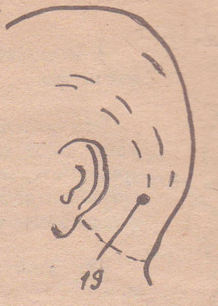

*Точка 19 за ухом* (стор. 8) — точки: [19](19.md)

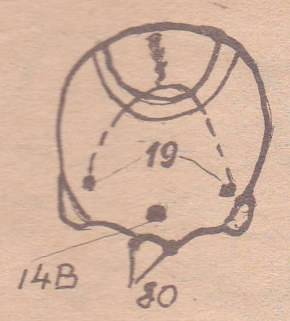

*Затылок: 19, 14B, 80* (стор. 8) — точки: [19](19.md), [14B](14B.md), [80](80.md)

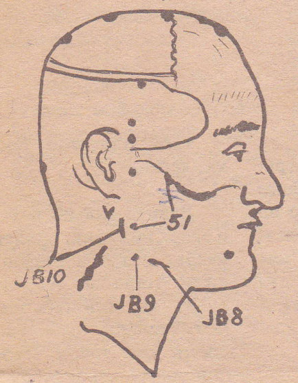

*Голова сбоку: 51, JB10, JB9, JB8* (стор. 8) — точки: [51](51.md), [JB10](JB10.md), [JB9](JB9.md), [JB8](JB8.md)

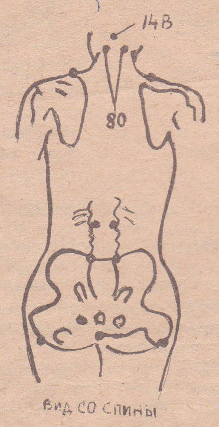

*Вид со спины: 14B, 80* (стор. 8) — точки: [14B](14B.md), [80](80.md)
