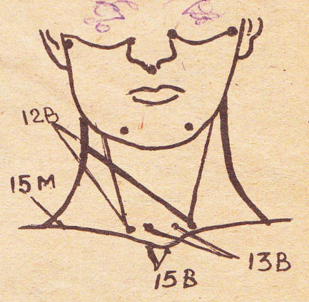
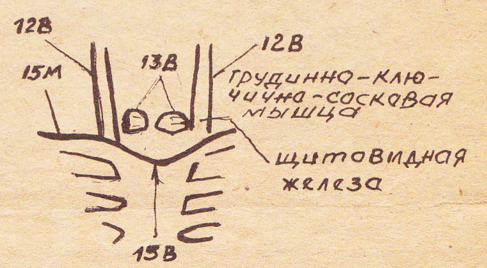
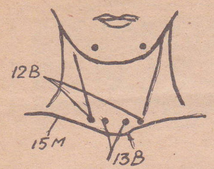

# 12B — Грудинно-ключично-сосковая мышца. Соматическая. Руки, сердце.

**Сегмент:** [Шия — Точки надавливания на шее](_segment.md) · **Джерело:** стор. 10 (PDF стор. 8) · **Соматична точка**

## Опис

Расположена по обеим сторонам основания шеи на переднебоковой стенке грудинно-ключично-сосковой мышцы, где кончается ключичная ямка. Левая точка "12B" контролирует левую сторону сердца (например, при грудной жабе) и левую руку. Правая сторона активизирует правую руку и правую сторону тела.

## Рукописні нотатки власника

- Від руки над заголовком: «Ангіна».

## Зображення

*Шея спереди: 12B, 15M, 15B, 13B* — малюнок біля опису, стор. 9

*Грудинно-ключично-сосковая мышца и щитовидная железа: 12B, 13B, 15M, 15B* — малюнок біля опису, стор. 9

*Шея спереди: 12B, 15M, 13B* — малюнок біля опису, стор. 10

## У покажчику («Указатель»)

- Руки
- Бурсит
- Сердце: ангина — левая

→ [Повний покажчик](../kody/ukazatel.md)
