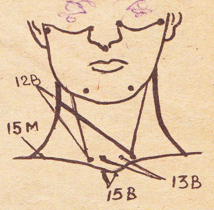
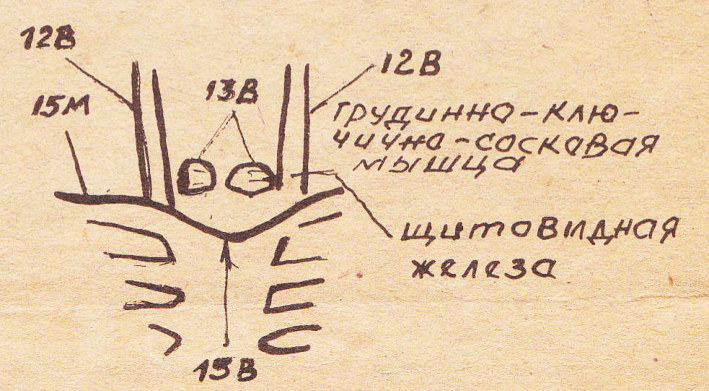
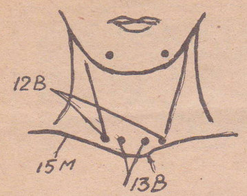
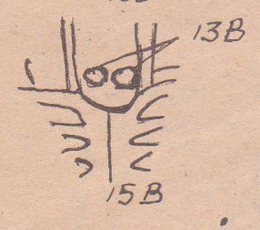

# 13B — Щитовидная железа. Метаболизм.

**Сегмент:** [Шия — Точки надавливания на шее](_segment.md) · **Джерело:** стор. 10 (PDF стор. 8) · **Соматична точка**

## Опис

Парная точка, т.к. щитовидная железа имеет две доли. Щитовидная железа связана с обменом веществ тела. Нарушение функции щитовидной железы может быть причиной сердцебиения, потери веса, а также избыточного веса. Щитовидная железа контролирует также температуру тела.

## Зображення

*Шея спереди: 12B, 15M, 15B, 13B* — малюнок біля опису, стор. 9

*Грудинно-ключично-сосковая мышца и щитовидная железа: 12B, 13B, 15M, 15B* — малюнок біля опису, стор. 9

*Шея спереди: 12B, 15M, 13B* — малюнок біля опису, стор. 10

*Щитовидная железа: 13B, 15B* — малюнок біля опису, стор. 10

## У покажчику («Указатель»)

- Глаза: выпученные глаза
- Сердце: эмоциональные
- Сердце: сердцебиение сильное
- Йод
- Пульс,снизить
- Щитовидная железа

→ [Повний покажчик](../kody/ukazatel.md)
