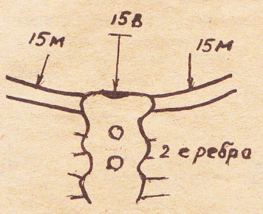
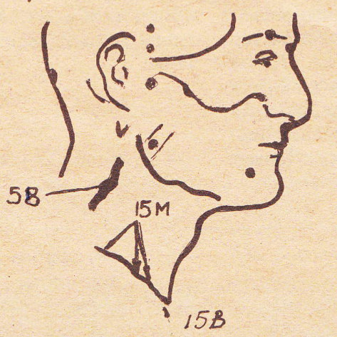
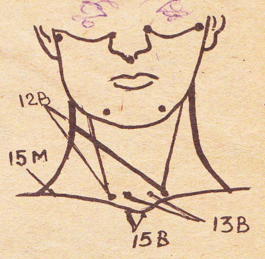
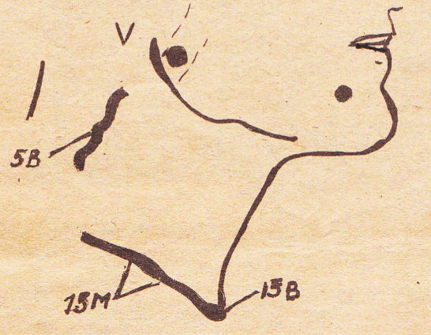
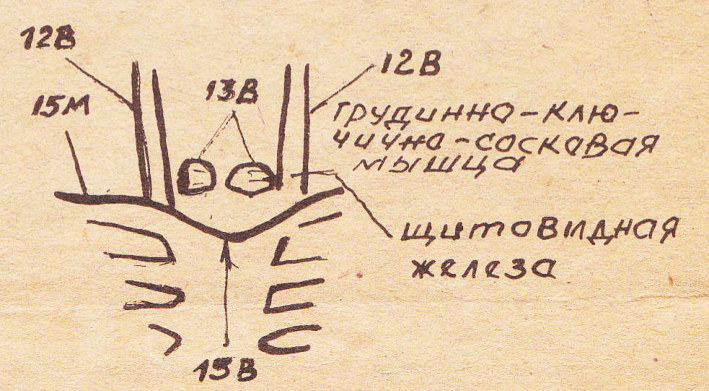
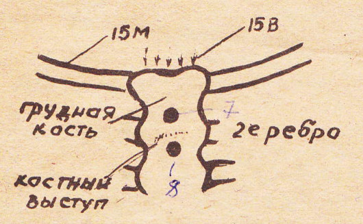
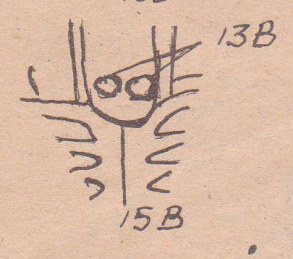

# 15B — Мозг, пищевод, грыжа, горло, опущение органов.

**Сегмент:** [Шия — Точки надавливания на шее](_segment.md) · **Джерело:** стор. 9 (PDF стор. 7)

## Опис

Верхний край грудины. Нажим на верхнюю часть этой кости открывает верхнее отверстие желудка, лечит пищевод и брюшные органы, такие как почки, матка и т.д. Это место также показано при вправлении грыжи, чтобы снять тяжесть со стенок брюшной полости и позволить самой природе излечить грыжу. Нажим на это место лечит также переднюю и заднюю часть горла. Место "15B" имеет форму чашки. Когда мы надавливаем на какую-либо боковую сторону этой чашки, мы лечим именно эту сторону горла и даже мозг.

## Зображення

*Грудина и ключицы: 15M, 15B* — малюнок біля опису, стор. 9

*Шея сбоку: 5B, 15M, 15B* — малюнок біля опису, стор. 9

*Шея спереди: 12B, 15M, 15B, 13B* — малюнок біля опису, стор. 9

*Шея сбоку (крупно): 5B, 15M, 15B* — малюнок біля опису, стор. 9

*Грудинно-ключично-сосковая мышца и щитовидная железа: 12B, 13B, 15M, 15B* — малюнок біля опису, стор. 9

*Грудная кость, 2-е ребра: 15M, 15B (от руки: 7, 8)* — малюнок біля опису, стор. 9

*Щитовидная железа: 13B, 15B* — малюнок біля опису, стор. 10

## У покажчику («Указатель»)

- Кашель
- Опущение органа
- Пищевод
- Геморрой
- Грыжа
- Хрипоты
- Гортань
- Органы выпадения
- Опущение
- Переломы
- Голос
- Вызывание рвоты

→ [Повний покажчик](../kody/ukazatel.md)
