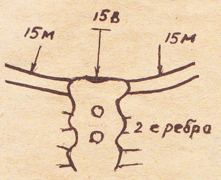
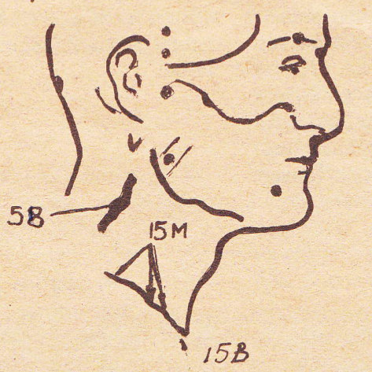
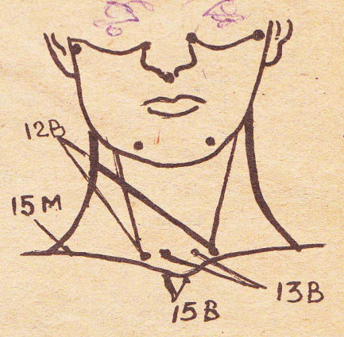
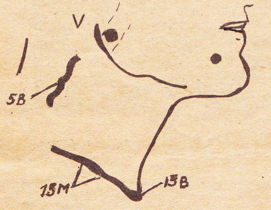
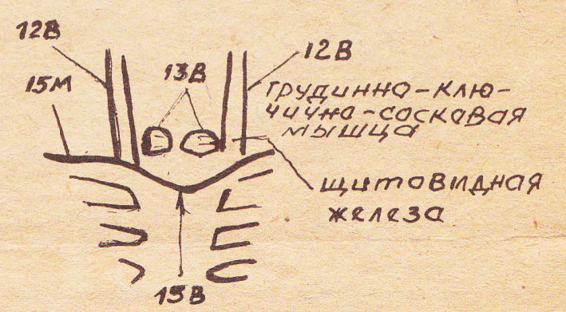
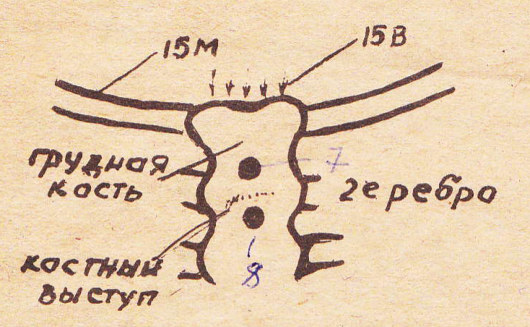
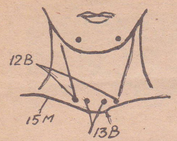

# 15M — Метаболизм.

**Сегмент:** [Шия — Точки надавливания на шее](_segment.md) · **Джерело:** стор. 10 (PDF стор. 8) · **Соматична точка**

## Опис

Верхний край обеих ключиц. Это место может влиять на обмен веществ и имеет очень большое значение.

## Зображення

*Грудина и ключицы: 15M, 15B* — малюнок біля опису, стор. 9

*Шея сбоку: 5B, 15M, 15B* — малюнок біля опису, стор. 9

*Шея спереди: 12B, 15M, 15B, 13B* — малюнок біля опису, стор. 9

*Шея сбоку (крупно): 5B, 15M, 15B* — малюнок біля опису, стор. 9

*Грудинно-ключично-сосковая мышца и щитовидная железа: 12B, 13B, 15M, 15B* — малюнок біля опису, стор. 9

*Грудная кость, 2-е ребра: 15M, 15B (от руки: 7, 8)* — малюнок біля опису, стор. 9

*Шея спереди: 12B, 15M, 13B* — малюнок біля опису, стор. 10

## У покажчику («Указатель»)

- Бурсит — левая
- Переваривание жиров
- Энергия
- Желчный пузырь
- Желчные камни
- Желтуха
- Гортань

→ [Повний покажчик](../kody/ukazatel.md)
