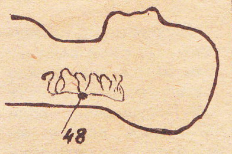
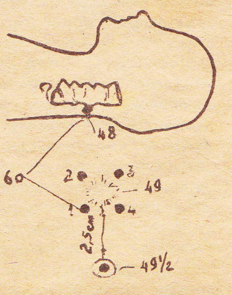

# 48 — Лимфа, грудной проток.

**Сегмент:** [Шия — Точки надавливания на шее](_segment.md) · **Джерело:** стор. 9 (PDF стор. 7)

## Опис

Непарная точка, расположенная приблизительно в центре задней части шеи на третьем отростке шейного отдела позвоночника. Эта точка очень важна для уравновешивания электрических сил в грудном протоке. Грудной проток - это главная артерия всех лимфатических сосудов тела, за исключением тех, которые находятся на правой стороне головы, шеи и грудной клетки, правого легкого и правой стороне сердца, а также выпуклой поверхности печени. Он передает большую часть лимфы и хилуса (млечного сока) в кровь. Грудной проток тянется вверх от второго поясничного позвонка до основания шеи. Для контроля эту точку надо надавливать первой.

## Примітки транскрипції

- У друці заголовок починається з «8.» (перша цифра не пропечаталась); від руки виправлено на «48». Код 48 підтверджується малюнком і покажчиком («Грудной проток-48», «Лимфа-48,73,45»).

## Зображення

*Точка 48 на шейном отделе позвоночника* — малюнок біля опису, стор. 9

*Точка 60: одновременно 48 и пупок* — малюнок біля опису, стор. 13

## У покажчику («Указатель»)

- Аденоиды
- Антибиотики
- Лимфа
- Грудной проток

→ [Повний покажчик](../kody/ukazatel.md)
