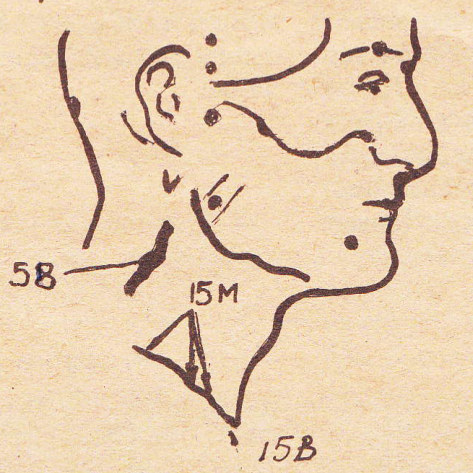
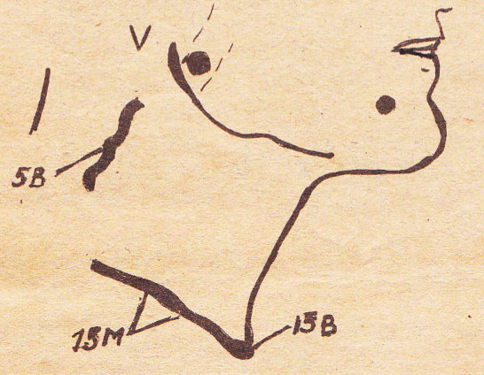

# 5B — СОМАТИЧЕСКАЯ. Брюшная полость.

**Сегмент:** [Шия — Точки надавливания на шее](_segment.md) · **Джерело:** стор. 9 (PDF стор. 7) · **Соматична точка**

## Опис

Этот участок расположен вдоль боковых шейных мышц у поперечных костных отростков позвоночника. Эти точки связаны с кишечником, толстой кишкой, аппендиксом и т.д. При надавливании надо быть очень осторожным. Давите очень мягко.

## Зображення

*Шея сбоку: 5B, 15M, 15B* — малюнок біля опису, стор. 9

*Шея сбоку (крупно): 5B, 15M, 15B* — малюнок біля опису, стор. 9

## У покажчику («Указатель»)

- Аппендицит — правая

→ [Повний покажчик](../kody/ukazatel.md)
