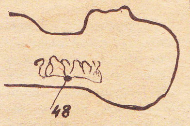
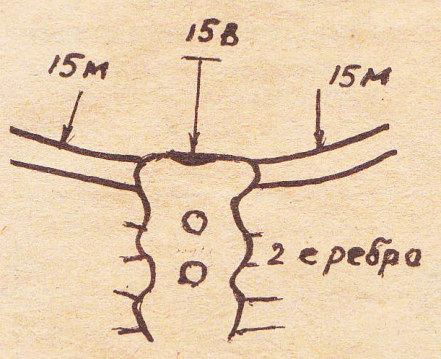
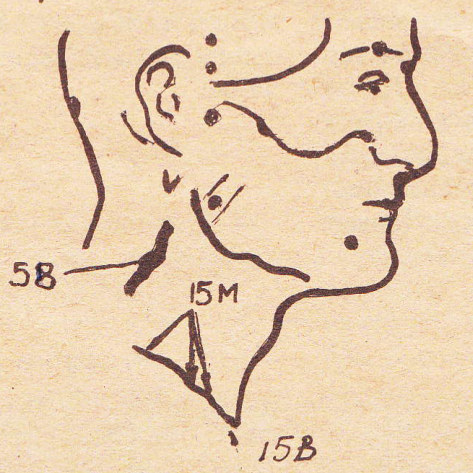
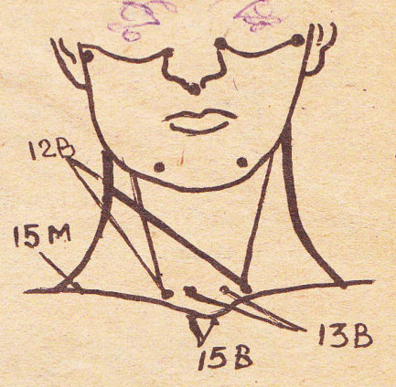
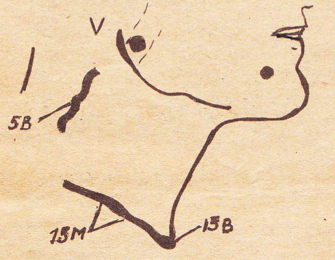
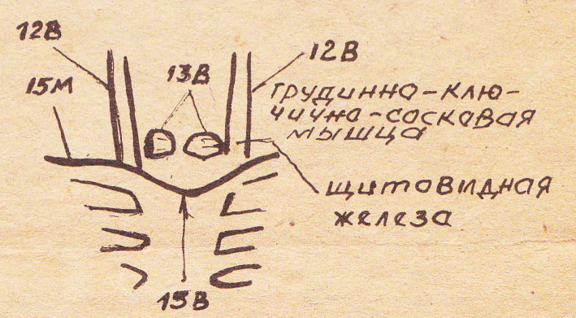
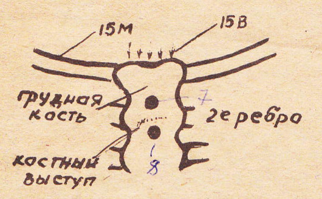
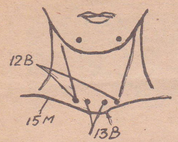
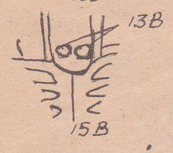

# Шия — Точки надавливания на шее

Сторінки джерела: 9–10.

## Точки

| Код | Заголовок | Стор. | Малюнків |
|---|---|---|---|
| [48](48.md) | Лимфа, грудной проток. | 9 | 2 |
| [5B](5B.md) | СОМАТИЧЕСКАЯ. Брюшная полость. | 9 | 2 |
| [15B](15B.md) | Мозг, пищевод, грыжа, горло, опущение органов. | 9 | 7 |
| [12B](12B.md) | Грудинно-ключично-сосковая мышца. Соматическая. Руки, сердце. | 10 | 3 |
| [15M](15M.md) | Метаболизм. | 10 | 7 |
| [13B](13B.md) | Щитовидная железа. Метаболизм. | 10 | 4 |

## Рукописні переліки точок угорі сторінок (червоним)

- стор. 9: 48, 5B, 15B
- стор. 10: 12B, 13B, 15M

## Малюнки біля описів

*Точка 48 на шейном отделе позвоночника* (стор. 9) — точки: [48](48.md)

*Грудина и ключицы: 15M, 15B* (стор. 9) — точки: [15M](15M.md), [15B](15B.md)

*Шея сбоку: 5B, 15M, 15B* (стор. 9) — точки: [5B](5B.md), [15M](15M.md), [15B](15B.md)

*Шея спереди: 12B, 15M, 15B, 13B* (стор. 9) — точки: [12B](12B.md), [15M](15M.md), [15B](15B.md), [13B](13B.md)

*Шея сбоку (крупно): 5B, 15M, 15B* (стор. 9) — точки: [5B](5B.md), [15M](15M.md), [15B](15B.md)

*Грудинно-ключично-сосковая мышца и щитовидная железа: 12B, 13B, 15M, 15B* (стор. 9) — точки: [12B](12B.md), [15M](15M.md), [13B](13B.md), [15B](15B.md)

*Грудная кость, 2-е ребра: 15M, 15B (от руки: 7, 8)* (стор. 9) — точки: [15M](15M.md), [15B](15B.md), [7](../03-tulub/7.md), [8](../03-tulub/8.md)

*Шея спереди: 12B, 15M, 13B* (стор. 10) — точки: [12B](12B.md), [15M](15M.md), [13B](13B.md)

*Щитовидная железа: 13B, 15B* (стор. 10) — точки: [13B](13B.md), [15B](15B.md)
