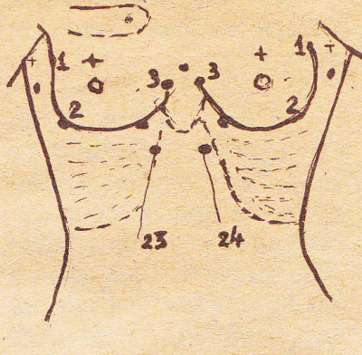
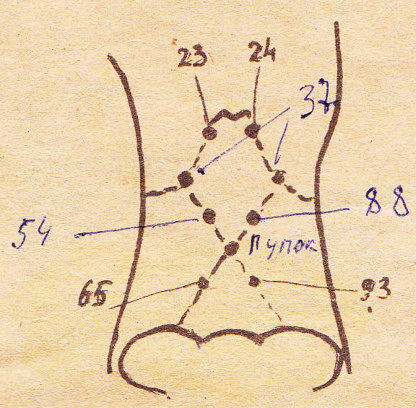

# 23 — Поджелудочная железа.

**Сегмент:** [Тулуб — Точки надавливания на туловище](_segment.md) · **Джерело:** стор. 13 (PDF стор. 11)

## Опис

Согнув указательный палец правой руки так далеко вверх, как можете достать на внутреннем крае правой части реберной клетки, вы коснетесь энергетического центра на поджелудочной железе.

## Зображення

*Края ребер: 23, 24* — малюнок біля опису, стор. 13

*Живот: 23, 24, 37, 54, 88, 65, 93* — малюнок біля опису, стор. 13

*Живот: 23, 24, 37, 54, 88, 65, 93* — зведена схема, стор. 10

*Ребра: 38, 39, 23, 24, 37* — зведена схема, стор. 10

*Туловище спереди: сводная схема* — зведена схема, стор. 10

## У покажчику («Указатель»)

- Переваривание сахара
- Стопа
- Метеоризм
- Инсулин
- Боль: поджелудочная железа
- Поджелудочная железа
- Сахар

→ [Повний покажчик](../kody/ukazatel.md)
