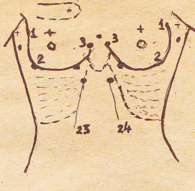

# 24 — Селезенка.

**Сегмент:** [Тулуб — Точки надавливания на туловище](_segment.md) · **Джерело:** стор. 13 (PDF стор. 11)

## Опис

Следуйте направлению, как для точки ["23"](23.md), но на противоположной, левой стороне реберной клетки. Вы коснетесь энергетического центра селезенки. Селезенка производит красные кровяные клетки, и если она не будет выполнять функцию надлежащим образом, может наступить анемия. Проверьте точку "24" также для проблем, связанных с голосом.

## Рукописні нотатки власника

- Від руки біля заголовка: «Анемия».

## Зображення

*Края ребер: 23, 24* — малюнок біля опису, стор. 13

*Живот: 23, 24, 37, 54, 88, 65, 93* — малюнок біля опису, стор. 13

*Живот: 23, 24, 37, 54, 88, 65, 93* — зведена схема, стор. 10

*Ребра: 38, 39, 23, 24, 37* — зведена схема, стор. 10

*Туловище спереди: сводная схема* — зведена схема, стор. 10

## У покажчику («Указатель»)

- Анемия
- Потеря голоса
- Кровяное давление, низкое
- Переваривание белков
- Энергия
- Боль: селезенка
- Пульс,повысить
- Селезенка
- Голос

→ [Повний покажчик](../kody/ukazatel.md)
