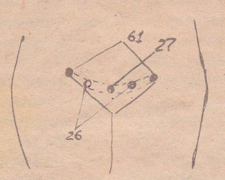
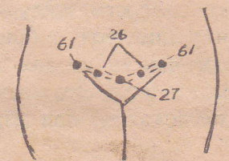

# 26 — Яичники, маточные трубы, семенные канатики.

**Сегмент:** [Тулуб — Точки надавливания на туловище](_segment.md) · **Джерело:** стор. 14 (PDF стор. 12)

## Опис

Это точка парная, расположена в центре каждой лобковой кости. Лечит яичники и маточные трубы у женщин, семенные канатики у мужчин. Одним из главных симптомов застоя крови в органах размножения является боль в ногах и нижней части спины и даже, в некоторых случаях, неспособность ходить. Если нельзя избавиться от застоя крови в этих органах путем обработки этих точек, то проверьте точку ["51"](../01-golova/51.md) (стр. 8), т.к. свинка может оставить свою метку на яичках или яичниках. Органы размножения состоят из чувствительных нервов, отсюда эмоциональные симптомы, возникающие в результате нарушений в этих областях, например, нервные расстройства во время менопаузы.

## Зображення

*Пах: 61, 27, 26* — малюнок біля опису, стор. 14

*Пах: 61, 26, 27* — зведена схема, стор. 10

*Туловище спереди: сводная схема* — зведена схема, стор. 10

## У покажчику («Указатель»)

- Отек брюшной полости
- Апоплексия
- Фаллопиевы трубы
- Половые железы
- Подагра
- Сердце: стопа — правая
- Боль в бедре
- Импотенция
- Инфекция — левая
- Боли в ногах
- Менструация
- Менструальные боли
- Шея
- Нервозность
- Яичники
- Боль: бедра
- Боль: ноги
- Половые органы
- Ишиас
- Секс
- Яички

→ [Повний покажчик](../kody/ukazatel.md)
