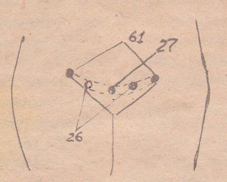
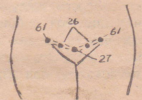

# 27 — Предстательная железа (простата) или матка.

**Сегмент:** [Тулуб — Точки надавливания на туловище](_segment.md) · **Джерело:** стор. 14 (PDF стор. 12)

## Опис

Непарная точка, расположена точно в середине, где сходятся лобковые кости. Эта точка лечит матку и шейку матки у женщин, простату у мужчин.

## Зображення

*Пах: 61, 27, 26* — малюнок біля опису, стор. 14

*Пах: 61, 26, 27* — зведена схема, стор. 10

*Туловище спереди: сводная схема* — зведена схема, стор. 10

## У покажчику («Указатель»)

- Отек брюшной полости
- Водянка
- Подагра
- Боль в бедре
- Импотенция
- Боли в ногах
- Менструация
- Менструальные боли
- Шея
- Нервозность
- Боль: ноги
- Предстательная железа
- Половые органы
- Ишиас
- Секс
- Матка

→ [Повний покажчик](../kody/ukazatel.md)
