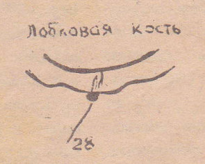
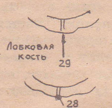

# 28 — Отеки.

**Сегмент:** [Тулуб — Точки надавливания на туловище](_segment.md) · **Джерело:** стор. 14 (PDF стор. 12)

## Опис

Указательным пальцем надавливайте под точкой ["27"](27.md) в направлении прямо и вниз. Лечит мочеточник и мочевой пузырь.

## Зображення

*Лобковая кость: 28* — малюнок біля опису, стор. 14

*Лобковая кость: 29, 28* — зведена схема, стор. 10

## У покажчику («Указатель»)

- Мочевой пузырь
- Цистит
- Отеки
- Мочеиспускательный канал
- Кровь в моче
- Болезненное мочеиспускание
- Задержка мочеиспускания

→ [Повний покажчик](../kody/ukazatel.md)
