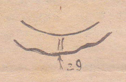
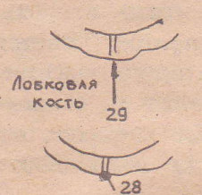

# 29 — Пенис или влагалище.

**Сегмент:** [Тулуб — Точки надавливания на туловище](_segment.md) · **Джерело:** стор. 14 (PDF стор. 12)

## Опис

Указательным пальцем надавливайте под точкой ["27"](27.md) в направлении вверх. Действует на влагалище или пенис.

## Зображення

*Лобковая кость: 29* — малюнок біля опису, стор. 14

*Лобковая кость: 29, 28* — зведена схема, стор. 10

## У покажчику («Указатель»)

- Пенис
- Влагалище

→ [Повний покажчик](../kody/ukazatel.md)
