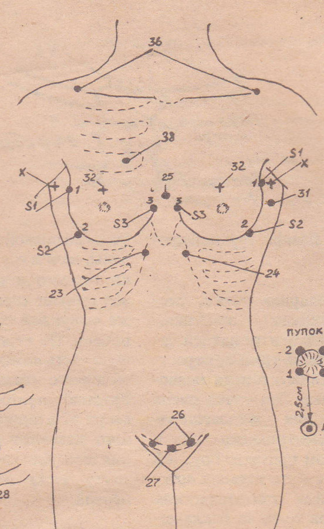

# 31 — Желудок, эмоции.

**Сегмент:** [Тулуб — Точки надавливания на туловище](_segment.md) · **Джерело:** стор. 12 (PDF стор. 10)

## Опис

Для желудка. Расположена на уровне левого соска на левой стороне реберной клетки под рукой.

## Зображення

*Грудь: 56, 30, 31, 37, 54* — зведена схема, стор. 10

*Туловище спереди: сводная схема* — зведена схема, стор. 10

## У покажчику («Указатель»)

- Пищеварение, эмоцион.
- Эмоциональный желудок
- Сердце: гиперемия
- Сердце: пищеварительные причины
- Сердце: эмоциональные
- Сердце: давление
- Расстройство пищеварения
- Желудок
- Желудок,эмоциональный

→ [Повний покажчик](../kody/ukazatel.md)
