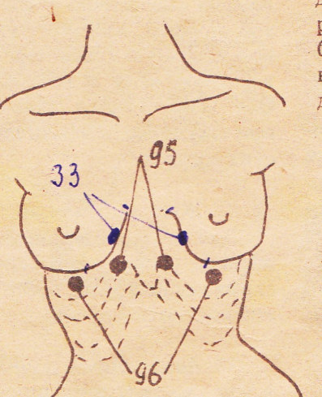
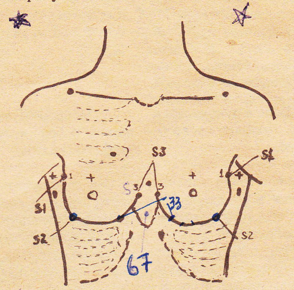

# 33 — Левая: левая почка и левая часть толстой кишки. Правая: правая почка и правая часть толстой кишки.

**Сегмент:** [Тулуб — Точки надавливания на туловище](_segment.md) · **Джерело:** стор. 12 (PDF стор. 10)

## Опис

### 33. Левая. Левая почка и левая часть толстой кишки.

### 33. Правая. Правая почка и правая часть толстой кишки.

На правой стороне эта точка лечит правую почку и правую сторону толстой кишки. На левой стороне она лечит левую почку и левую сторону толстой кишки. Расположена под нижней стороной грудных желез на ребрах посередине между самой нижней частью грудной железы и точкой, где грудная железа касается грудины. Лечит почечные боли.

## Зображення

*Ребра: 38, 39, 37 (от руки: 95, 33)* — малюнок біля опису, стор. 11

*Грудь: 95, 96 (от руки: 33)* — малюнок біля опису, стор. 11

*Грудь: 25, 32, 30, 33* — малюнок біля опису, стор. 12

*Грудь: S1, S2, S3 (от руки: 33, 67)* — малюнок біля опису, стор. 12

*Туловище спереди: сводная схема* — зведена схема, стор. 10

## У покажчику («Указатель»)

- Почки
- Почечные боли
- Боль: спина
- Боль: почки

→ [Повний покажчик](../kody/ukazatel.md)
