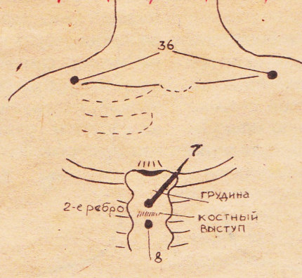

# 36 — Боли в руках, шее и плечах, дыхание, кровообращение.

**Сегмент:** [Тулуб — Точки надавливания на туловище](_segment.md) · **Джерело:** стор. 11 (PDF стор. 9)

## Опис

Парная точка излечивает боли в руках, шее и плечах, облегчает дыхание и кровообращение от печени к сердцу. Расположена ниже наружного конца ключицы, где он встречается с плечевым выступом.

## Зображення

*Ключицы и грудина: 36, 7, 8* — малюнок біля опису, стор. 11

*Туловище спереди: сводная схема* — зведена схема, стор. 10

## У покажчику («Указатель»)

- Руки
- Дыхание
- Бурсит
- Плечевые кости

→ [Повний покажчик](../kody/ukazatel.md)
